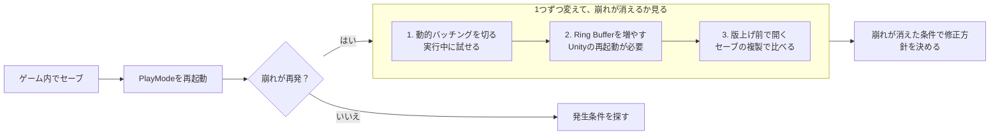
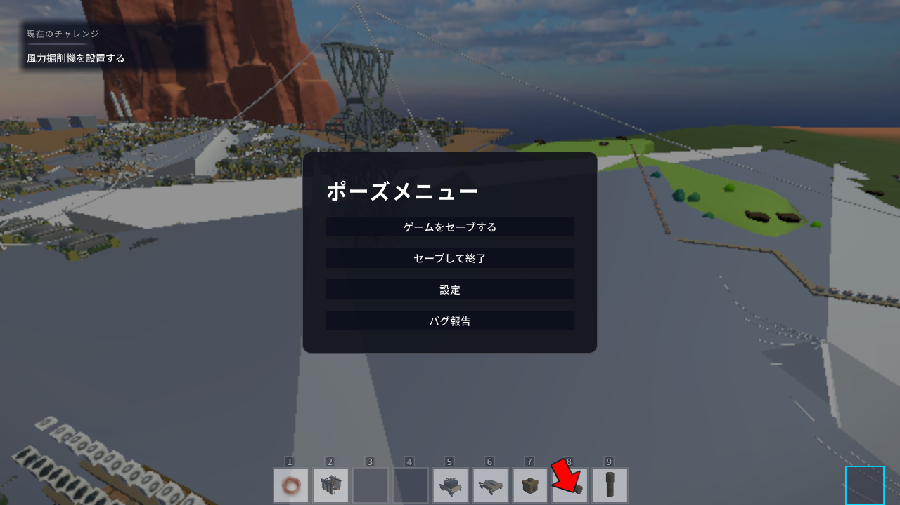
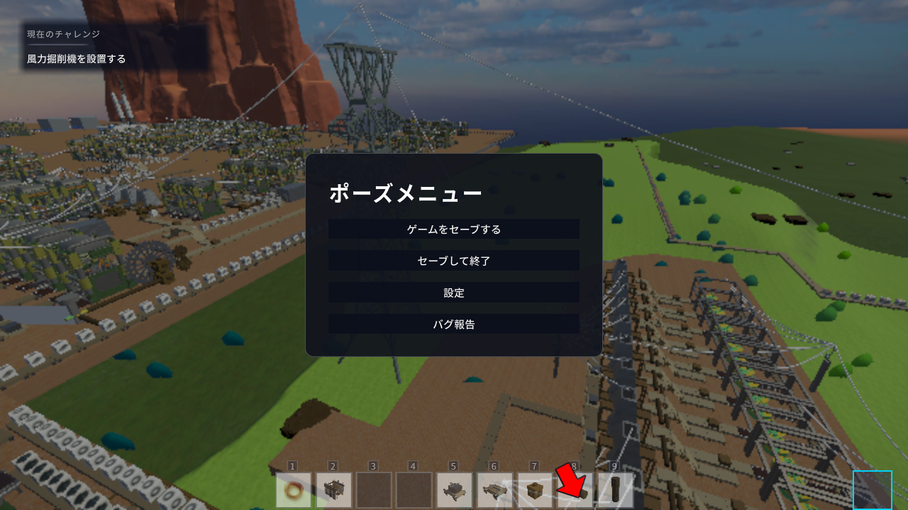

# 電線メッシュの描画崩れ 調査ドキュメント

調査日: 2026-11-23 ／ タスク: `moorestech-0o01`

## 結論と現状

**描画崩れの発生源は電線 `ElectricWireLine` 541本だと実測で確定した。なぜ壊れたかは未確定で、コードは修正していない。**

調査中に電線メッシュの頂点属性を足して外したところ、表示が正常に戻った。戻った理由は、GPU側のメッシュが作り直されたためと見ているが、これは推測である。次回の起動やプレイ中に再発する可能性がある。

調査で変えた表示設定はすべて元に戻した。アセットとセーブデータは変更していない。

## 症状と発生環境

プレイ中に、灰色と白の巨大な板が工場と地形を覆った。UnityのErrorログは0件だった。

| 項目 | 実測値 |
|---|---|
| 観測日時 | 2026-11-23 10:45〜10:53 JST |
| Unity | 6000.6.10f1、EditorのPlayMode |
| GPU・API | Apple M5、Metal |
| コード | `master` 7f3d0afe48、未コミット差分あり |
| マスターデータ | `moorestech_master` 77b86b6（手元のピン変更） |
| シーン | MainGame |
| 描画設定 | High、描画解像度 0.5倍、GPU Resident Drawer 有効、Forward+ |
| Renderer数 | 267,531 |
| 電線 | 541本、各 68頂点・384インデックス、位置と法線のみ |

CPU側の電線メッシュに、非数・巨大座標・範囲外インデックスはなかった。最大の辺は14.8mで、画面を覆う板の大きさと合わない。

## 切り分け結果

電線の描画だけを消すと板はすべて消え、他の候補を消しても板は残った。実験はすべて実行中の値だけを変えて行った。

| 試したこと | 結果 | 判定 |
|---|---|---|
| 電線541本のRendererを無効化 | 板がすべて消えた | **発生源** |
| カメラから `Default` レイヤーを除外 | 板がすべて消えた | 発生源はこの層にある |
| `Block`・`Ground`・`MapObject` を除外 | 板は残った | 発生源ではない |
| 重なる地形 `Environment/Terrain` の描画をオフ | 緑の面だけ消え、板は残った | 主因ではない |
| 2本目の Directional Light をオフ | 板は残った | 主因ではない |
| GPU Resident Drawer をオフ | 板は残り、形がフレームごとに変わった | 単独の原因ではない |
| 電線メッシュにUVと接線を追加 | 正常に戻った | 回復した |
| 追加したUVと接線を削除 | 正常なまま | 属性不足だけでは崩れない |
| 動的バッチングをオフ | 試験コードがコンパイルエラーで未実行 | **未検証** |

## 原因の仮説

以下の3案はすべて推測で、まだ実測で確かめていない。共通する見立ては、CPU側は正常なので、GPU側のデータか描画処理で壊れたというものだ。

| 順位 | 仮説 | 今ある手がかり | 確かめ方 |
|---|---|---|---|
| 1 | Graphics Ring Buffer の枯渇で電線の描画データが壊れた | `Ran out of Graphics Ring Buffer space` が1回出た。崩れとの前後関係は未確認 | `-gfx-ring-buffer-size` を増やし、再発しなければ支持 |
| 2 | 動的バッチングが電線をまとめる処理で壊れた | 電線は68頂点と小さく、全541本が同じマテリアル。設定値は未確認 | 動的バッチングを切り、崩れが消えれば支持 |
| 3 | Unity 6000.6.10f1 と Metal の組み合わせの不具合 | 版上げ直後に発生した | 同じセーブの複製を版上げ前のコミットで開き、再発しなければ支持 |

## 次の調査手順

最初にPlayModeを再起動し、崩れが再発するかを確かめる。再起動すると未セーブの進行は失われる。

再発したら、手間の小さい順に1つずつ条件を変える。再発しなければ、プレイを続けて崩れる直前の操作とログを記録する。

**未決:** 再発確認を今のワールドで行うか、複製で行うか。

## 証拠と参照先

| 種類 | 場所 |
|---|---|
| タスク台帳 | `moorestech-0o01`（親作業の候補: `moorestech-z0jc`） |
| 電線メッシュの生成 | `moorestech_client/Assets/Scripts/Client.Game/InGame/BlockSystem/StateProcessor/ElectricWire/CatenaryWireMeshBuilder.cs` |
| 電線の表示 | 同じフォルダの `ElectricWireLineViewElement.cs` |
| 直近の描画設定変更 | 35b4f8e9fb（GPU Resident Drawer 有効化、PR #1700） |

下の2枚は同じカメラ位置で撮った、崩れていたときと回復後の画面である。

**崩れていたとき（10:47）**

**回復後（10:53）**

