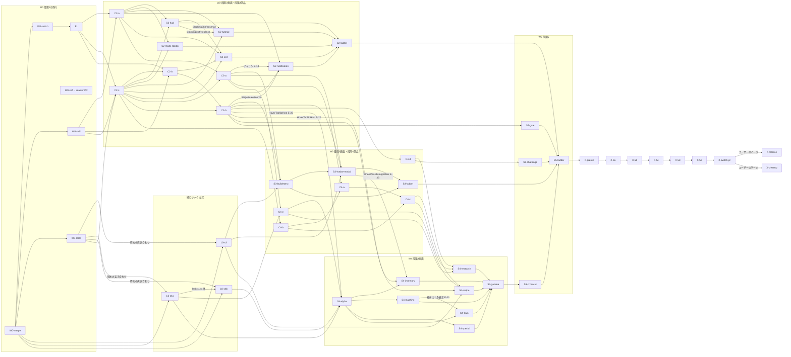

# UITK 移行 実行計画（レーンの DAG・波・並列と直列）

> **For the conductor (指揮):** この文書は段階 1 の残りから切替後の後片付けまでを「レーン」の DAG として並べた実行の正本。レーンの中身は各レーンの詳細計画（moores-writing-plans 形式）が正本で、部品の API・置き場・USS・テストの型は `component-architecture.md` が正本。両者とこの文書が食い違ったら、裁定 → 統合計画（`origin/master:docs/uitk-migration/plan.md`）→ 設計書 → この文書 → 詳細計画の順で上が勝つ。**例外: レーンの切り方・依存・部品とファイルの持ち主（§1・§6・§8）だけはこの文書が設計書に勝つ**（設計書 §5.2 は初期提案）。

- **ゴール（ユーザー原文の要旨）**: 「WebUI と同じ見た目で、適切な設計、コンポーネント化された UITK ベースの UI を開発すること」。ユーザーは重要な意思決定だけに関わる
- **出発点**: `origin/feature/uitk` = `54c8a4c8c8`（段階 1 済み）、`origin/master` = `e95dc17db1`。調査 5 本は `research/`（stage1-asbuilt・web-components・merge-delta・tests-ladder・cef-record）
- **従う裁定**: 2026-11-06 の UITK 6 本と CEF 停止の記録 1 本（長命ブランチ・一気切替・全体スイッチ 1 つ・追従はブランチ側で記帳し未移植画面より優先・配らず Editor の中だけで確認・全段階 Web と同じ見た目・レーンは moores-code-review を通して agent が `feature/uitk` へマージコミット・master への PR は CEF 停止の記録と切替 PR の 2 本でマージはユーザー）
- **判断の出所**: 裁定に無い判断は「agent 既定」と書き、§8 に ID（`E-n`）で並べた。ユーザーに上げる設計判断は 0 件（全体レビューで Q-1・C2-c D-1・W0-cef D-13 を裁定から導いた agent 既定へ下げた。E-11・E-14・E-15）。ユーザーが関わるのは §7 のマージ・目視・独立レビューの裁定だけ
- **パスの略記**: `S/` = `moorestech_client/Assets/Scripts/`、`W/` = `moorestech_web/webui/src/`、`P/` = `docs/superpowers/plans/`

---

## 0. 要点

1. **レーンは 51 本、8 つの波**（W0 段階 1 の残り → W1 段階 2 の部品 → W2 段階 2 の画面と段階 3 の部品 → W3 段階 3 の画面と段階 4 の部品 → W4 段階 4 の画面 → W5 段階 5 → W6 撤去と切替 PR → W7 切替後）。常駐の integrator 作業 2 本（週次の取り込み・追従）が全波を貫く
2. **クリティカルパス**は `W0-merge → W0-switch → F1 → C2-c → C3-a → C4-e → S4-alpha → S4-inventory → S4-machine → S4-train → S4-gamma → S5-crosscut → S5-ladder → X-prerun → X-5a…5e → X-switch-pr`（§2.2 の各波で最も長い枠の直列の鎖）。律速は Editor の本数（Mac mini で同時 2 本）で、段階 2・3 の画面は Editor 枠の隙間で並走させる
3. **今すぐ詳細計画を書くレーンは 12 本**（`detail_now=true`。§6.1）。段階 3・4 の部品レーンと段階 4・5 の画面レーンは、前の段の部品 API が `feature/uitk` に入った時点で詳細計画を切る（§6.2）
4. **ユーザーが関わるのは 5 点**（§7）: マージ 2 本（CEF 停止の記録・切替 PR）、目視 1 回（切替 PR）、独立レビューの裁定 2 回（全体スイッチの作り直し・切替 PR）、切替後の戻しの判断（不具合が出たときだけ）、切替後の台帳・G1 撤去 PR のマージ。設計判断の裁定は 0 件（文字の 13px 下限 `Q-1` は裁定から導いた agent 既定 E-11）
5. **設計書のレビューフロー**（§5）: 詳細計画は「設計検査 → user-simulator → 目的だけ渡した評価役 2 体（opus と Codex）→ 再現できた指摘だけ判断に上げる」を通ってからレーンを起こす

---

## 1. レーン表

列: **ID**／題／段階／波／依存（何が先に要るか・理由）／**Ed**＝Editor 要否（要／否／末＝最後の compile とテストの 1 回だけ枠を借りる）／担当（単位＝単位エージェント〈Codex〉、int＝integrator、指揮、ユーザー）／詳細計画（`●`＝今書く `P/2026-11-06-uitk-<id>.md`、`○`＝波の着手時に `P/<着手日>-uitk-<id>.md`）／完了条件

### 1.1 W0 段階 1 の残り（段階 2 の前）

| ID | 題 | 依存 | Ed | 担当 | 計画 | 完了条件 |
|---|---|---|---|---|---|---|
| W0-merge | master を `feature/uitk` へ取り込み、束 1 を暗転へ戻す（albof.20） | なし | 否 | int | ● | `docs/uitk/TODO.md` の衝突 2 か所を merge-delta §5 の推奨で解く・束 1 を `暗転`・束 1 の 3 行の所有者を `Web`・未記帳 2 件（`3e946e4bd3` 写した、`5421c7f9f0` 捨てた〈W0-switch で外す〉）を記帳。この実行計画一式（`docs/uitk-migration/execution/`・12 本の詳細計画。設計書は全体レビューの改訂〈§7.1 の A-18〜A-39〉と評価役 2 体の指摘の反映〈A-40〜A-48〉を反映済み）も同じ PR で入れる。`check-uitk-web-follow.py --base <前> --head <後>` が全束 0 件、`.github/scripts/tests/test_uitk_web_follow_*.py` 5 本が OK、G1 緑の PR をマージコミット |
| W0-cef | CEF 停止の記録を master へ切り出す（albof.18） | なし（`origin/master` から切る） | 要 | 単位 | ● | cef-record §3〜§5 の差分。`WebUiInputExclusivityWebSilenceTest`(3)・`WebUiHealthManifestTest`(4)・`CrashBundleWebUiHealthTest`・既存 6 本の ctor 更新が緑（regex は cef-record §5）。録画 `playtest-receiver/developer-report-interrupt`・`developer-report-delivery` で manifest `schemaVersion 6`・`webUiHealth` 3 値を assert、Web 入力欄を使う既存シナリオ 1 本で抑止が従来どおり。EditModeInPlayingTest 一式で LogError の増減を記録。pr-create で **master へ PR**（報告ページ付き）。マージはユーザー。マージ後の最初の取り込み（I-weekly）で cef-record §6 の表を当てる |
| W0-switch | 全体スイッチ 1 つへの作り直し（albof.17） | W0-merge（束 1 が暗転でないと旧 R1 の撤去が G1 で落ちる） | 要 | int | ● | 所有表・`UiOwnershipEditorOverride`・`UiSurface`・`MainPanelOwner`・旧 R1 の Web 側変更（`a97575e5b5`・`1095cab8bf`・`ccb3d512f7`・`5421c7f9f0` の Web 部）を外し、Editor 限定・既定 Web のスイッチ 1 つ（plan §3.3 R1〜R4、設計書 C10・[A-16]）。UITK 側は Web ホストを起動しない。片側読みの L0（`UiPointerHitTest`・`UiInputExclusivity`・ロケータ）、`CompositeUiElementLocatorTest`(10) を片側版へ書き換え、`UiOwnershipTableTest` 削除、`UiInputExclusivityWebSuspensionTest` 書き換え。L3 `GameUiSkeletonTest`・`PauseMenuGameUiTest`・`GameUiInputTest` を UITK スイッチで緑。録画 `uitk-lifeline`・`uitk-nested-pause-skit`・`uitk-nested-pause-train` を UITK 側で、`misc/pause-menu-hierarchy` を Web 側で master と同じ合否。UITK 側で WS 接続 0・CEF の RawImage 無し、Web 側で `GameUiRoot` の層が空（L3 で観測）。外した Web コミットを `捨てた（理由）` で記帳。pr-independent-review を付ける（ユーザーの裁定 1 回） |
| W0-skill | `ref-uitk-design` 新設と moores-code-review の UITK 観点（albof.19） | W0-merge | 否 | 単位 | ● | `.agents/skills/ref-uitk-design/`（SKILL.md 200 行以内＋references 3 本。設計書 §6 の目次）。`.agents/skills/moores-code-review/references/moores-reviewer-digest.md` に UITK 観点（PickingMode の既定・スイッチの片側読み R2・トークン直書き・`clicked`/`Action` のイベント・部品の中身を外から塗る・層の依存方向）を追記。create-skill のレビューモードで合格 |
| W0-tools | 検証の道具: テスト名の突き合わせ・disposition の書式・EDC の無言素通し（dww3） | W0-merge | 末 | 単位 | ● | `tools/uitk/test-name-parity.mjs`（Web の Playwright/vitest 名と NUnit の `/// <web-test>` コメントと `docs/uitk/disposition.md` を突き合わせ、束ごとの差分を出す）と自己テスト。段階 1 の束で実行し差分を disposition に起こす。dww3: EDC のコンパイル失敗でシナリオが非 0 で落ちる（壊した 1 本で実証）。wwxy の 10 本を S2-ladder・S3-ladder・X-prerun へ割り振った表を台帳に書く |
| F1 | 基盤整え | W0-switch（スイッチと composition root を先に確定） | 要 | int | ● | 設計書 §1.4 の C1（tss 束ね・`UiAssetCatalog` 撤去・ctor の `StyleSheet` 撤去）・C4（`MantineTokens.uss` 生成・`DerivedTokens.uss`・`ControlTokens.uss` 撤去）・C5（層の分割と追加）・C6（`UiFamily`・`UiStageFrame`）・C8（`OnClicked`）・C9（`LocalizedLabel.SetText(UiText)`。`UiText` を辞書キー・コンテンツ辞書キー・解決済みの文の 3 種に [A-40]）・[A-7] namespace・`UiCommandResultToaster`・`Client.Ui.Editor` の部品ギャラリーの枠・台帳「見た目の例外」と `LX-1..3`・tss の族別区画（E-1）・`HoverTooltipMark` の印 API（E-6）・文字の 13px 下限の撤去（E-11・[A-39]）・**C2-a/b/c の前提（トークン・読み口）**: `DerivedTokens.uss` の C2-a のつまみ既定と前計算色（`--panel-*`・`--title-*`・`--game-panel-craft-*`・`--paper-*`・`--hud-*`）と C2-c の 3 名（`--scrollarea-scrollbar-size`・`--game-scroll-view-thumb-hover`・`--shortcut-hint-label-gap`）と C2-b の `--mantine-color-blue-light-hover`、`mantineTokenNames()` の C2-b の 3 名（`blue-light-color`・`disabled`・`disabled-color`）、`UssCustomStyleReader.TryReadNumber`。L2 新設 `UiThemeImportBundleTest`・`UiLayerDependencyDirectionTest`・`LookExceptionLedgerTest`・`MantineTokenParityTest`・`CalcConstantRecheckTest`、`UiLayerOrderTest` 改修、L1 `UiStageFrameTest`（720p・2560×1080）・`UssKnobInheritanceTest`（`--slot-size` 1 本）、既存 `Client.Tests/Ui` 272 件が緑。録画 `uitk-lifeline` で見た目が段階 1 と同じ（参照と並べ比べ） |

### 1.2 純ロジックの移植（Editor の要らない枠で W0 から並走）

| ID | 題 | 依存 | Ed | 担当 | 計画 | 完了条件 |
|---|---|---|---|---|---|---|
| L0-s3 | 段階 3 の純ロジック | W0-merge（締めの突き合わせは W0-tools） | 末 | 単位 | ● | 先頭で S12（`dotnet test`）を 1 日で試し、結果を台帳へ。`W/features/buildMenu/logic/buildMenuGrouping.test.ts`(14)・`buildMenuScrollSpy.test.ts`(12)・`sessionState/buildMenuSessionState.test.ts`(4)・`useBuildMenuCategoryScroll.test.ts`(13 の計算部分)・`hotbar/hotbarDnd.test.ts`(3)・`modal/modalLogic.test.ts`(8)・`shared/placementTarget/selectableTarget.test.ts`(9)・`shared/pointerGesture/dragThreshold.test.ts`(5)・`buildMenuShortage`・`materialTooltipText` を `S/Client.Ui.State/<機能>/Logic/` へ。`SlotAmountFormat`（`shared/ui/slotAmountFormat.test.ts`(7)）も L0-s3 が `S/Client.Ui.State/Text/` に作る [A-19]。テストは `S/Client.Tests/Ui/State/<機能>/`、各テストに `/// <web-test>` で元の名前。突き合わせスクリプトで束 3 の L 差分 0 |
| L0-s4a | 段階 4 の純ロジック（持ち物・レシピ） | W0-merge（締めの突き合わせは W0-tools） | 末 | 単位 | ● | `W/shared/itemMove/*`(33)・`ownedCounts`・`features/inventory/slotActions.test.ts`(8 の計画部分)・`splitDrag`・`equipmentLogic`・`inventoryGridColumns`・`recipe/logic/holdCraftLogic.test.ts`(9)・`craftLogic.test.ts`(9)・`recipeSlotLayout`・`levelInheritanceBadge` を `S/Client.Ui.State/ItemMove/`・`Inventory/`・`Recipe/` へ。突き合わせで該当 L 差分 0 |
| L0-s4b | 段階 4 の純ロジック（ブロック UI・研究・列車） | W0-merge（Task 1〜10 は L0-s4a と並走可。Task 11 以降は L0-s4a の取り込み後。締めの突き合わせは W0-tools） | 末 | 単位 | ● | `W/features/blockInventory/**/*Logic*.test.ts` 群（detailLogic 7・beltThroughput 7・machineSlotGhosts 13・machineRecipeSelection 5・cleanRoom 2＋4・filterSplitter 4・rocketLaunchPad・spaceElevator・machineInputStall 2・blockInfoFetch 1・blockInventoryKeydown 4・blockComponentRegistry 10）・`inventory/blockSlotRestriction.test.ts`(7)・`research/researchLogic.test.ts`(21)・`unlockEntries`・`train/timetableEditLogic.test.ts`(6) を `S/Client.Ui.State/BlockInventory/Logic/`・`Research/Logic/`・`Train/Logic/` へ（段階 0 の既存ディレクトリは 10 ファイル上限で下位へ割る）。突き合わせで該当 L 差分 0 |

### 1.3 W1 段階 2 の部品

| ID | 題 | 依存 | Ed | 担当 | 計画 | 完了条件 |
|---|---|---|---|---|---|---|
| C2-a | 面・装飾 | F1・W0-skill（比べ方の手順 `compare-procedure.md`） | 要 | 単位 | ● | `GamePanel`（C7: default・craft・`SetTitle(UiText)`・`SetTitleAction`。外周の影は描かない [A-22]）・`GamePanelSurface`（hud・skit）・`PaperSurface`・`FadeRule`・`HudSectionHeading`。各 L1（状態 1・つまみ上書き 1・拾わない装飾・描画エラーなし。イベントを持つ部品は無い）、台帳「## 実測の結論」に影の実測 1 行、ギャラリーの見本、参照からの切り抜きと並べた比較。本番の画面から未使用なので録画なし（詳細計画の判断記録に 1 行） |
| C2-b | 操作・入力 | F1・C2-c（`LocalizedTextBinding`・[A-31]）・W0-skill | 要 | 単位 | ● | `IconButton`・`FormButton`（variant は Web を grep して決める。文言は `UiText` [A-40]。クラフトは C4-c の `RecipeActionButton` [A-46]）・`GameTextField`（`GameTextFieldLook`・`SetPlaceholder`・USS）・バグ報告の画面 USS 直書きをこれらへ置換（C2）・albof.12 の 8 項目を現物で照合して残りを直す・`BugReportFormViewTest`（201 行）を 200 行以下へ分割。L1 各部品、`BugReportFormViewTest`(11)・`BugReportDescriptionHeightTest`(2) 緑。録画 `uitk-lifeline`、Mac の合成キーで IME 1 回（plan §4.9） |
| C2-c | 文字・表示・スクロール | F1・W0-tools（束 1 の突き合わせ）・W0-skill | 要 | 単位 | ● | `GaugeBar`・`TooltipFace`・`GameScrollView`・`KeyCap`・`ShortcutHintLabel`・Typography のクラス（Title は Web と同じ px＋letter-spacing で `LX-1` を消す [A-37]、太さは Bold/Medium の字形 [A-36]、2 行の行送りの方法を実測して台帳へ [A-48]）・`UiStack`/`UiGroup`・`LocalizedTextBinding`。設定・サブページのスクロールを `GameScrollView` へ置換（C3）。albof.16.2（言語設定の結果型の統合・画質プリセット導出の重複。設定 3 topic の `SettingsModel` 購読化は C2-c 計画 D-9 によりしない〈X-5c で Web ごと消える・言語ゲートが DI より前〉）。L1 各部品、`SettingsViewTest`(10)・`PauseMenuViewTest`(10) 緑、Web `pauseMenuSettingsLayout.spec.ts`(2) を L1 のレイアウト照合で写す。録画 `uitk-lifeline`・`graphics-quality/quality-ui-switching`（UITK 側）。設定画面の比較でスクロールバーの差が消えている |

### 1.4 W2〜W5 の部品と画面（`○`＝波の着手時に詳細計画を切る）

| ID | 題 | 段階・波 | 依存 | Ed | 担当 | 完了条件（使う部品・移すテスト） |
|---|---|---|---|---|---|---|
| S2-hud | 常駐 HUD（Crosshair・KeyHintHud・ProgressBar・TrainRidingHud・CurrentChallengeHud）と画面の幕・ヴィネット | 2・W2 | C2-a・C2-c | 要 | 単位 | 部品: `GamePanelSurface`(hud)・`HudSectionHeading`・`FadeRule`・`GaugeBar`（`--gauge-fill` 上書き）・`KeyCap`（kbd。`ShortcutHintLabel` は使わない [A-59]）・`PaperSurface`。HUD の出し分けは Web `App.tsx` の条件の写し [A-57]。blocking スキットは `BlockingSkitPresence` を作って配り、`MainGameUiRegistration` の本体に登録する。モード名は `SkitPresentationData.BlockingMode` の定数（`Client.Skit` の 1 行の例外）[A-56]。`Screens/Shell/`: `ScreenBackdropPresenter`（`Initialize` で購読する `PauseMenuScreenPresenter` と同じ形。`Backdrop` 列で幕 `screen-backdrop` を `UiLayer.Backdrop` の Viewport 族へ。色は S2-hud が `DerivedTokens.uss` へ α 補正した行を入れる [A-55]）と常時のヴィネット（`--screen-vignette-*` を頂点カラーで。% は Foundation に足す `UssCustomStyleReader.TryReadPercent` で読む [A-59]）。L1 で traits の全画面の行ごとに `Backdrop` 列と View の出し入れ（Presenter の結線は録画 `uitk-hud`）、並べ比べにポーズ・インベントリ相当の幕を含める [A-44]。目標・詳細の 2 行以上の文は C2-c の実測で決めた行送りの方法で行高トークン（20px・25px・1.2）と 1px 以内（L1）[A-48]。写す: commonHud 2（残り 4 件は S2-mode-tooltip 3・S2-skit 1）・keyHint・progress（P9・C4・S3）、`challenge/hudLayout.spec.ts`(5)、`challenge.spec.ts` の HUD 4 件、`train.spec.ts` の HUD 1 件、`alwaysOnHudWheel.test.ts`(1。残り 2 件は S3-hotbar-modal・S4-inventory) [A-58]。アンカー `challenge.current-hud` |
| S2-mode-tooltip | 操作モード HUD と CursorTooltip | 2・W2 | C2-a・C2-c | 要 | 単位 | 部品: `GamePanel`(craft)・`HudSectionHeading`・`TooltipFace`。斜線帯は画面内（Painter2D）。CursorTooltip は `OFFSET`（現在 12）参照・端で押し戻す（Web `W/shared/tooltip/tooltipPosition.ts` の clamp。旧記述「端で反転」は Web の実物と違った）・ロック中は画面中央。写す: modeHud 17（P6・I6・S5）、`shared/tooltip/*`(8)、`system/commonHud.spec.ts` の 3 件（設置情報と削除警告帯・ツールチップ 2 件）と「採掘進捗・クロスヘア・tooltipのtopic eventを表示する」の tooltip の半分（S2-hud と同じタグ）、`commonHud/alwaysOnHudWheel.test.ts` の「%s は入力を奪わない」の it.each の 3 行（配置モード・削除モード警告・カーソルツールチップ。このレーンの `ModeHudPickingTest` に同じタグで写し、S2-hud の `AlwaysOnHudPickingTest` は書き換えない）[A-58]。録画 `misc/cursor-tooltip-follows-crosshair` |
| S2-tutorial | チュートリアル枠・KeyControlHint・ワールドピン | 2・W2 | C2-a・C2-c・S2-hud（blocking スキットの判定 `BlockingSkitPresence`〈S2-hud が作る。W2a 設計書 A-56〉を使う。枠 1 で S2-hud の後） | 要 | 単位 | アンカーの枠（祖先クリップ ADR 0024・脈動 1200ms・ラベル反転・二重解決の LogError）、アンカーのカバレッジ L1（plan §4.5）。写す: KeyControlHint・WorldPin（P6・C4）、`system/worldPin.spec.ts`(6)、`TutorialOverlay.test.ts`(17)・`tutorialAttentionDesign.test.ts`(21)・`system/tutorial.spec.ts`(6)・`tutorialHighlightClip.spec.ts`(1)（E-8 で段階 5 から前倒し）、`portalLayerScaling.spec.ts` のピン・枠 3 件、`commonHud/alwaysOnHudWheel.test.ts` の「%s は入力を奪わない」の it.each のキー操作ヒントの 1 行（このレーンの `KeyControlHintTest` に同じタグで写し、S2-hud の `AlwaysOnHudPickingTest` は書き換えない）[A-58]。DragGuide（`W/features/tutorial/overlay/DragGuide.tsx`。2 つのアンカーを結ぶ `kind: dragGuide` の要素）を `Screens/Tutorial/` に作り、`TutorialOverlay.test.ts` の drag guides を写す（E-16） |
| S2-skit | スキット一式と全体非表示 | 2・W2 | C2-a・C2-b・C2-c・S2-hud（`BlockingSkitPresence`・`SkitPresentationData.BlockingMode`・`Client.Ui.State.asmdef` の `Client.Skit` 参照・store の登録を S2-hud が置く [A-56]） | 要 | 単位 | 部品: `GamePanelSurface`(skit・skit-choice [A-84])・`IconButton`×4（`--icon-button-size` 上書き）・`FadeRule`。`SkitTransition` 層（F1 で追加済み）、タイプライタ（残り文字を透明にして配置固定 [A-82]）、背景スキット、表示の正は store [A-81]、Enter は `InputManager.UI.SkitAdvance` [A-83]、Ctrl+U とカットシーンの全体非表示（`GameUiRoot.SetWholeUiVisible` [A-80]）。写す: `skit.spec.ts`(4)・`skitPauseInput.spec.ts`(3。3 件目は for で 2 回走り展開 4)・`phaseC4.spec.ts`(2。「cutscene state withdraws every web UI layer」は全体非表示を見る)・`skit/interaction.test.ts`(5)、`system/commonHud.spec.ts` の `ui.visibility=false` の 1 件 [A-58]。NUnit は定義 46・展開 49（Web から写さない入力 2 件・store の特性 1 件を含む）。720p と 2560×1080 の Web 並べ比べが成立するまでマージしない。録画 `misc/skit-opening-spawn-relative-origin`・`uitk-nested-pause-skit`。計画 `P/2026-11-07-uitk-s2-skit.md` |
| S2-notification | 通知 | 2・W2 | C2-a・C2-c・C3-a（アイテム獲得のアイコンに `GameContentPresentation`）・C3-b（左端を実画面 16px に保つ倍率の読み口 `StageScaleSource` [A-41]）。L0 の Task 1〜4 は依存なしで先行可。E-19 | 要 | 単位 | 通知のストアを C# のモデルへ（`NOTIFICATION_DISPLAY_MS` 参照、入場 160ms・退場 200ms）、背面の層。写す: notification 47（P6・L26・S15。`it` の行で 48、`it.each` を展開すると 50。件数の正本は S2-notification 計画の件数表）、`portalLayerScaling.spec.ts` の通知 1 件の処遇。録画 `server-notification-smoke`（wwxy を直して） |
| S2-ladder | 段階 2 の締め | 2・W2 末 | S2-* 全部 | 要 | int | ラダー `uitk-opening-hud` を作り、ラダー 1〜2 が UITK 側で緑。wwxy の `tutorial-*` 3 本と `server-notification-smoke` を直す。`challenge.current-hud` のハイライトの録画。L3 1 本（段階 2 の HUD が UITK スイッチで出る・消える）。束 2 の突き合わせ差分 0（他の束のレーンへ「写す予定」で回した件〈S2-hud 計画 D-13: `alwaysOnHudWheel.test.ts` の 2 件〉は除く。除いた件は受け手のレーンの完了条件に入る）、G1 束 2 で 0。codex-audit（画像付き）で波の並べ比べ |
| C3-a | スロット族 1 | 3・W2 | C2-a・C2-c・F1（`HoverTooltipMark`） | 要 | 単位 | 設計書 §2.3: `UiIcon`・Content（`GameContentPresentation`。名前は `UiText.FromContent` [A-40]）・`GameIcon`・`SlotFrame`（リングは装飾子・`--bevel-inset` の outset/inset で外側成長と内側食い込みを切り替え、L1 で持ち物とホットバーの両方の面寸法・外周寸法を確かめる。先頭でキーワードのつまみを Foundation に足す `UssCustomStyleReader.TryReadKeyword` で読めるか確かめる [A-42・A-59]。選択の白面の下端の帯は USS の `var()` で受け C# で計算しない [A-51]）・`SlotContent`・`ItemSlot`・`BlockSlot`・`PlacementTargetFace`・`SlotGrid`（`SlotAmountFormat` は L0-s3 が `Client.Ui.State/Text/` に作り済みで使うだけ [A-19]）。写す: `shared/ui` の C12・L34 のうちスロット分、`regression/itemSlot.spec.ts`(1。ツールチップの 1 件は S4-inventory が写す予定。C3-a 計画 D-20)。L1・ギャラリー・比較 |
| C3-b | 相互作用 | 3・W2 | C2-b・C2-c | 要 | 単位 | `UiPressGesture`（`usePressGesture` の 5px を参照）・`UiDragDrop`・`HoverTooltipHost`（印の付いた要素を含む `ScrollView` のスクロールで引っ込め、無関係なパネルのスクロールでは引っ込めない、ポインタ座標の実変化でだけ開き直す、捕捉中は出さない。Web `HoverTooltip/index.tsx` の意図を L1 3 件で写す [A-43]）・`UiScreenPixelScope` と倍率の読み口 `StageScaleSource`（`IReadOnlyReactiveProperty<float> Scale`、解像度の変更で更新。S2-notification が左端に使う）（Foundation/Stage。先頭で `panel.scaledPixelsPerPoint` が PanelSettings の倍率と一致するかを 720p・1080p・2560×1080 で実測して台帳へ。L1 で中身の幅 320 が倍率 1.5 でも実画面 320px [A-41]）・`ModeSwitch` の縦・タブ・個別無効（`OnSelected`→`OnOptionSelected`）・`GameScrollView` のスクロールスパイの口・`UiModalHost`（中身を `UiScreenPixelScope` に置く。同時 1 件・フォーカスは閉じ込めない [A-77]）・`DialogFrame`（幅は Mantine `--modal-size` の 440px [A-77]）。倍率の式は `StageScaleMeasure` 1 本・見張りは `StageScaleWatch` 1 点 [A-75]。Foundation の USS の tss 区画 `Foundation/Tooltip`・`Foundation/Modal` を足す（E-20）。L1 で `MouseMove` の PointerEnter の罠と ScrollView の `GeometryChangedEvent` を先に確かめて台帳へ。計画 `P/2026-11-07-uitk-c3-b.md` |
| S3-buildmenu | ビルドメニュー | 3・W3 | C3-a・C3-b・L0-s3 | 要 | 単位 | 面は `--icon-pad: 4px`（面 = `--slot-size` − 8px）で写し、C# はクリップの逃げを導く [A-101]（[A-47] の改め）。配置対象の絵の出どころ（`Client.Ui.State/PlacementTarget/`・`Content/PlacementTargetIcons`）とホットバーへの落としの受け口 `IHotbarDropReceiver` を作る（S3-hotbar-modal は使うだけ）[A-100]。写す: `placementIconCentering.spec.ts` のビルドメニューの件。計画 `P/2026-11-07-uitk-s3-buildmenu.md`。3 カラム・縦 `ModeSwitch`・`GameTextField`(SearchInput)・1 本のスクロールにスクロールスパイと smooth scroll（UiMotion）・詳細の sticky・BP 右クリック削除・不足ツールチップ・セッション復元・ドラッグ源。アンカー `build-menu.entry-*`。写す: P21・C22（L30 は L0-s3 済み）。録画 `misc/webui-buildmenu-click`・`connect/electric-wire-tool-*` 5 本・`building/blueprint-place-like-block`。視口 `IBuildMenuScrollViewport` は `AppliedSpacerHeight`（レイアウト確定後のスペーサ実寸）も返す [A-49]。完了条件に「L0-s3 計画『後段レーンへ渡すもの』の 5 点を満たす」: (1) スペーサ反映後の `GeometryChangedEvent` で `OnLayoutChanged()` を呼び、末尾ジャンプが末尾群の見出しへ届くことを L1 か録画 `misc/webui-buildmenu-click`（末尾カテゴリへのジャンプ）で確かめる (2) `AppliedSpacerHeight` は実寸を返し、反映後の高さで保存位置を復元することを L1 で確かめる (3) 復元前に ScrollView が `OnScrolled(0)` を流すと保存位置が 0 に潰れる（Web と同挙動）かを実機で確かめる (4) 張り替え時に新しい視口へ `SpacerHeight.Value` を当て直す (5) 検索語・入力文は非 null で渡す。(3)〜(5) は L0-s3 done.md「integrator への依頼」由来 |
| S3-hotbar-modal | ホットバーとモーダル | 3・W3 | C3-a・C3-b・L0-s3・S2-hud・S3-buildmenu | 要 | 単位 | ホットバー 9 枠（`SlotFrame` のベベル上書き・`--bevel-inset: inset` [A-42]・`PlacementTargetFace`・割当/入替/解除の落とし先・`wheel-passthrough`・床トークン）、モーダル層と BP 名（`DialogFrame`・`FormButton`・`GameTextField`、描画者を UITK に一本化。題・本文・ボタン文言は `UiText.FromVerbatim` [A-40]。モーダルは実画面 px で 720p・1080p の並べ比べ [A-41]）。写す: hotbar（P6・C7）、modal（P4、L8 は L0-s3 済み）、`placementIconCentering.spec.ts` のホットバーの件（ビルドメニューの件は S3-buildmenu）。S3-buildmenu の `PlacementTargetIcon`・`PlacementTargetIcons`・`IHotbarDropReceiver` を使い、ビルドメニューのファイルは書かない [A-100]・[A-105]。ホットバー画面の USS で `--slot-frame-face` を世界の地向けに上書きし減光の Linear 合成を補正（bd albof.34）[A-108]。`Foundation/Input/WheelPassthroughMark` を作る [A-109]。計画 `P/2026-11-07-uitk-s3-hotbar-modal.md`。写す（S2-hud から）: `commonHud/alwaysOnHudWheel.test.ts`「クリックを持つスロット列だけが入力を取り戻し…」（bd `moorestech-albof.30`） |
| S3-ladder | 段階 3 の締め | 3・W3 末 | S3-* | 要 | int | ラダー `uitk-build-bp` を作り 1〜3 が緑。ビルドメニュー → ホットバーの D&D（L1。`AssignHotbar(1,id)` が 1 回だけ、`SelectBuildMenu` は 0 回）。wwxy の BP 2 本・電線 1 本・視点切替 1 本を直す。検索欄の入力中にゲームのキーが動かない・ESC はフォーカスを外すだけ（L1）。束 3 の突き合わせ差分 0・G1 0・codex-audit |
| C4-a | スロット族 2（液体） | 4・W3 | C3-a・C4-b | 要 | 単位 | `FluidSlot`・`FluidAmountSlot`・`FluidSlotRow`（`Components/Slots/Fluid/`。中身と量は判別 union `FluidSlotContent`・`SlotAmountBadge` [A-95]）。`GameContentPresentation.FluidFace`、サーバーの液体の色の起動時検証（`FluidMasterUtil.Validate`）と `FluidContainer` の容量の検査 [A-96]、`OutlinedCountLabel` の縁の色のつまみ（C4-a と S3-hotbar-modal の先に入ったほうが足し、後のレーンは使うだけ）[A-97・A-108]。`FluidSlotRow` は最後の Task で C4-b の `ProgressArrowBar` を待つ [A-98]。写す: `fluidLogic` 3・`FluidSlot.icon` 3・`FluidSlot.localization` 3・`FluidAmountSlot` 5・`iconTextOutlineDesign` の液体分 3（計 17。捨てる 2 は disposition に理由）。計画 `P/2026-11-07-uitk-c4-a.md` |
| C4-b | 進捗 | 4・W3（C2-c が済んでいるので W3 を待たず空いた Editor 枠で先行する。E-21） | C2-c | 要 | 単位 | `BarSeries`・`ProgressArrowGlyph`（Painter2D・drop-shadow は輪の頂点カラー〈σ はぼかしの値そのもの〉）・`ProgressArrowBar`（帯状・`name` 固定 `progress-arrow-bar`）。値の丸めは Gauges の `GaugeRatio.Clamp01` 1 本（`GaugeBar` も置き換える）。写す: `BarSeries`・`ProgressArrowGlyph` の vitest 8 件と `shared/clamp01.test.ts` 4 件（`ProgressArrowBar` は Web に vitest が無く L1 の最小）。計画 `P/2026-11-07-uitk-c4-b.md`（A-85〜A-89・LX-56〜60） |
| C4-c | レシピ部品 | 4・W3 | C4-a・C4-b・C2-c | 要 | 単位 | `RecipeRow`（独自 grid の裁定 `2026-08-20-レシピ行は独自gridを維持しSlotGridの例外とする`）・`LevelInheritanceBadge`・`RecipeListScrollView`（右の余白は C# で 2 つのつまみを足す [A-47]）・`RecipeActionButton`（Components/Controls。横 3 色グラデの面を頂点カラーで、通常・ホバー・無効の 3 組のつまみ。L1 で 3 状態の色とクラフト・研究の 2 組の上書き。Web の直書き色の既定は C4-c が `DerivedTokens.uss` の末尾の C4-c ブロックへ入れる [A-126]（[A-46] の改め））。`MachineRecipeSelectionRow.test.ts`(5) はデータからの結線を見るので S4-machine が写し、C4-c は同じ見た目と挙動をタグ無しの部品 L1 で固定する [A-127]。計画 `P/2026-11-09-uitk-c4-c.md`（A-120〜A-129・LX-91〜100） |
| C4-d | ノードグラフ | 4・W3 | C3-b | 要 | 単位 | `NodeGraphView`（パン・ズーム 0.4〜2.5・慣性 τ=325ms・Painter2D の線・仮想化しない）。写す: `shared/treeView/**`（C17・L12）。計画 `P/2026-11-09-uitk-c4-d.md`（A-115〜A-119・LX-86〜90） |
| C4-e | 掴み層と分割ドラッグ・舞台の上段 3 列 | 4・W3 | C3-a・L0-s4a（C3-b の型は使わない。E-22） | 要 | 単位 | Foundation の Grab 層に掴み絵 1 つ（絵は `Screens/GrabOverlay/` の画面部品・表示は State の `GrabOverlayModel`。追従は同じフレームの InputSystem のポインタの位置の流れ。`PointerMoveEvent` は拾わない所で届かない）[A-90] [A-91]、分割ドラッグ・右ドラッグ配り。Foundation/Stage の `StageColumnsLayout`（`Inv`・`Viewer`・`Items` の枠、上 `--menu-upper-safe-area`・左 `--stage-padding-left`・右 `--stage-padding-right`・列間 `--stage-column-gap`、研究画面だけ左 0〈畳む画面は `UiScreenTraits.CollapsesStageLeftPadding` の列。入口は `GameUiStageColumnsInstaller`〉。L1 で 3 列の x 位置と研究画面の左端を Web の参照から測った値と 2px 以内）[A-45] [A-92]。写す: `inventory/grabOverlay.spec.ts`(2)・`inventory.spec.ts` の掴み 3 件。slotActions の持ち主の分け方は [A-93]、拒否理由は [A-94]。掴み絵は既存の参照に無いので、レーンが mock-host で掴んだ状態の Web の参照を 1280×720 と 2560×1080 で撮り、掴み絵の領域（枠の寸法・個数の字・ベベル）を UITK と比べた表を done.md に置く（E-22）。計画 `P/2026-11-07-uitk-c4-e.md` |
| S4-alpha | 持ち物の中核 | 4・W4 頭 | C4-e・C3-a・C3-b（`HoverTooltipHost`・`GameScrollView` の口。E-22）・L0-s4a・L0-s4b | 要 | 単位 | 拡張口 6 つ（blockType ごとの本文・題の操作・標準の本文の固定順の区画・列車の本文・大型パネルの判定・Shift 配分の束縛）を作り、他の S4 レーンは自分のディレクトリと登録ファイルから差し込む。解放済みの機械レシピの源 `UnlockedMachineRecipeSource`（`Client.Ui.State/Recipe/Source/`）を作る（machine・recipe は使うだけ。E-23）。計画 `P/2026-11-10-uitk-s4-alpha.md`。`BlockInventoryPanel` の外殻（`StageColumnsLayout` の `Viewer` 枠へ [A-45]）・`blockComponentRegistry`・`SectionStackView`・`BlockItemGrid`・`Parts/`（`LackHighlightText`・rows）・スロット操作のコマンド配線（ItemMove の計画 → 型付きコマンド）。写す: `blockInventory.spec`(3)・`blockInventoryGestures`(5)・`blockRegistryCoverage`(1)・`regression/sectionStack`(1)・`SectionStackView.test`(8。alpha 3・machine 5)・`blockInventoryDesign`(S16。alpha 6・他レーン 10)・localization(S2)・`LackHighlightText/index.test`(2)。区画の中身にかかる件は持ち主（machine・special・train）が同じタグで写す（S4-alpha 計画の「写すテスト」表）。プレイヤー側の実行器・分割ドラッグ・進入・掴みの中身は C4-e の口（`PlayerSlotRef`・`PlayerItemActionConversion.TryConvert`・`PlayerItemActionExecutor`・`IPlayerSlotDragCommands`〈開始と進入。確定は C4-e が解放の後の LateTick で行う [A-91]〉・`IPlayerInventoryOperations`・`PlayerGrabModel`）を使う。`TryConvert` が false の計画はブロック側の実行器へ。L0-s4a の申し送り（`DestinationFull` の扱い・`BlockSlotPlanner`・`DirectMovePlanner`）はこのレーン [A-93] |
| S4-inventory | インベントリ・装備 | 4・W4 | S4-alpha・C3-b（`HoverTooltipHost`。ツールチップの 1 件〈bd `moorestech-albof.29`〉。E-22）・S3-hotbar-modal（`WheelPassthroughMark` [A-109]。E-23） | 要 | 単位 | InventoryPanel・EquipmentPanel（ホイール循環を C# 1 か所へ・床トークン）・スロットへのアンカーの印付け（`TutorialAnchor.Mark`。DragGuide 自体は S2-tutorial。E-16）。写す: inventory 62 件（P20・C16・L26。L26 は L0-s4a 19 件と L0-s4b の `blockSlotRestriction` 7 件が写し済み、P のうち掴み絵の 5 件は C4-e、`blockInventory*` は S4-alpha）のうちこのレーンの 31 件、束の外 3 件を足した 34 件（32 件を写し 2 件を処分表へ。S4-inventory 計画 D-5）、`regression/inputLayer.spec.ts` のホイール 1 件、`regression/itemSlot.spec.ts` のツールチップ 1 件（C3-a から。bd `moorestech-albof.29`）、`commonHud/alwaysOnHudWheel.test.ts`「装備HUDは実UIのままホイールだけ素通す」（S2-hud から。bd `moorestech-albof.31`）。パネルは `StageColumnsLayout.Get(StageColumn.Inv)` へ載せる [A-92] |
| S4-recipe | レシピビューアと一覧 | 4・W4 | C4-c・C4-e（`StageColumnsLayout`）・L0-s4a・C3-b（`UiPressGesture`・`HoverTooltipHost`）・L0-s3（`UiDragThreshold`） | 要 | 単位 | RecipeViewer（`Viewer` 枠）・ItemListPanel（`Items` 枠 [A-45]。6 列・クラフトは `RecipeActionButton` [A-46]・長押しクラフトはパネルのスケジューラ・コンテナクエリは `GeometryChangedEvent`）。アンカー `recipe.craft-button`・`recipe.item-<itemId>`。写す: recipe 52（P19・C8・I1。L24 は L0-s4a 済み）。パネルは `StageColumnsLayout.Get(StageColumn.Viewer)`／`Get(StageColumn.Items)` へ載せる [A-92]。一覧（`ItemListPanel`）に `WheelPassthroughMark` を付けない（装備のホイールの抑止は S4-inventory が素通しでない UI の上で止める。S4-inventory 計画 D-6） |
| S4-machine | 機械と汎用族 | 4・W4 | S4-alpha・C4-a・C4-b・C4-c | 要 | 単位 | 機械（レシピ選択とインベントリの往復）・採掘機・発電機・ポンプ・清浄機・入力の詰まり。写す: `blockDetails`(8 名のうち機械・採掘機・ポンプ・発電機・液体の面。歯車とフィルタの面は S4-special。分け方は S4-machine 計画の対応表)・`machineGestures`(3)・`machineRecipe`(10)・`machineRequiredCount`(4)・`MachineRecipeSelectionRow`(5)（C4-c が「写す予定」に記帳 [A-127]）・`cleanRoom/*`(8)・`fluidSlot`(5) と対応する C（MachineSection 9・SelectedRecipeHeader 2・ModuleSlotStackLimitText 2・CleanRoom 7・MachineInputStall 3）。alpha の持ち主表から `SectionStackView.test` 7（machine だけ 5・alpha と共有 2）・`regression/sectionStack` 1（共有）・`blockInventoryDesign` 10（machine だけ 7・共有 3）を同じタグで写す（S4-machine 計画「写すテスト」）。録画 `tier9/*` の機械系・`misc/cleanroom-room-usability`、機械 UI を開いたまま更新される録画 |
| S4-special | 特殊族 | 4・W4 | S4-alpha・C4-b | 要 | 単位 | FilterSplitter・ElectricToGear・GearToElectric・ElectricPole・Gear・ベルトの流量（`BarSeries`）・ロケット・宇宙エレベーター。写す: `blockDetails` の歯車とフィルタの面（S4-machine 計画の対応表で S4-special に回したもの。歯車機械のトルク・RPM・網、歯車発電機、歯車ポンプの歯車行、`renders ${type}` の gearMachine・filterSplitter）・`electricPole`(1)・`electricToGear`(1)・`filterSplitter`(3)・`spaceElevator/*`(8)・C（GearToElectric 7・BeltThroughput 3・RocketLaunchPad 5・SpaceElevator 5・Gear 3）。録画 `connect/rotary-generator-ui`・`tier9` のロケット 2 本 |
| S4-train | 列車族 | 4・W4 | S4-alpha・C4-a・S4-machine（液体の中身表示 `Screens/BlockInventory/Fluid/` の `FluidInventoryContents`・読み手 `IBlockFluidSlotsModel`。E-23） | 要 | 単位 | 列車インベントリ・駅名（IME）・プラットフォーム・時刻表（楽観更新）。写す: 20 件（`train.spec` 1・`timetable.spec` 2・`TrainTimetableImmediate` 8・`TrainTimetableSection` 5・`TrainInventoryBody` 1・`trainPlatform.spec` 2・`TrainPlatformInventory` 1。L6 は L0-s4b 済み）＋`blockInventoryDesign` の共有 2 件（S4-train 計画「写すテスト」）。録画 `uitk/uitk-train-inventory`（新設）・`train/train-timetable-via-ui`（両系で通る形に直す）・`train/train-station-default-name`・`train/fluid-inventory-via-interact` |
| S4-research | 研究ツリー | 4・W4 | C4-d・C3-a・C4-c（`RecipeActionButton`）・C4-e（`StageColumnsLayout`）・L0-s4b | 要 | 単位 | ResearchTreePanel（`NodeGraphView`）・ノードカード 4 状態・詳細ペイン・解放物・研究ボタン（`RecipeActionButton` に無効の面を `rgb(50 52 67)` へ上書き [A-46]）。研究画面の左余白 0 は `StageColumnsLayout`（畳む画面は `UiScreenTraits.CollapsesStageLeftPadding`。研究の行は C4-e が true で入れ済み）[A-45]。アンカー `research.node-<guid>`（マスタ 7 件）。写す: research 55（P19 から `tmp-icon-click` を除く・C14。L22 は L0-s4b 済み）。録画 `tier9/tier9-5-compute-research`。研究の右の領域の `left` は画面 USS（列ではない）。左の余白の畳みは `StageColumnsLayout` と画面の性質の列が持ち、このレーンは触らない [A-92] |
| S4-gamma | 段階 4 の締め | 4・W4 末 | S4-* 全部 | 要 | int | 同時に出る組（playerInventory・subInventory・researchTree）の L3、ラダー `uitk-production-loop`・`uitk-research-train` を作りラダー 1〜4 緑、UITK 側で全録画（全本の 2 回目）、マスタのアンカー 9 件が実ゲームで解決、`UIElementsUpdatePanels`＋`RepaintPanels` を台帳に 1 回記録、束 4 の突き合わせ差分 0・G1 0・codex-audit |
| S5-challenge | チャレンジ一覧 | 5・W5 | C4-d・C2-a・C2-b | 要 | 単位 | `NodeGraphView` の再利用・カテゴリのボタン列（`FormButton` の文言は `UiText.FromContent` [A-40]）・`PaperSurface` のノードカード・`FormButton`。写す: `challenge.spec.ts` 3 件（画面 2 件＋常駐 HUD 維持 1 件） [A-58]・`challengeLogic.test.ts`(2) |
| S5-gate | 出展モードの言語ゲート | 5・W5 | C2-b・C3-b | 要 | 単位 | Web は `--ui-scale` を掛けないので中身を `UiScreenPixelScope` に置く [A-41]。DI より前に出す全画面ゲート（`GameUiRoot` を起動の早い段で使うか、ゲート用パネルを分けるかを詳細計画の頭で決める＝agent 既定）。辞書を通さない文言を C# 定数へ。写す: eventLanguageGate(9) |
| S5-crosscut | 横断層の残り | 5・W5 | S4-gamma | 要 | 単位 | UI の例外を LogError と manifest へ（`AppErrorBoundary` の代わり）、再接続オーバーレイ・辞書エラー・`ConnectingPlaceholder` は作らず disposition に理由（[A-13]・[A-38]。統合計画 §2.6 との差は E-17）。写す: `system/i18n.spec`(2)・`allScreensI18n`(6)・`uiState.spec`(5)・`regression/inputLayer.spec`(4。ホイールの 1 件は S4-inventory)・`textSelection`(2) の意図 |
| S5-ladder | 段階 5 の締め | 5・W5 末 | S5-* | 要 | int | ラダー `uitk-challenge-gate` を作り 6 本緑。UITK 側で DSL の Web ロケータが一度も要素を返さない（ログ）。`Client.Tests/Ui/Anchor/TutorialAnchorCoveragePending.cs`（未移植のアンカーの表。S2-tutorial が作る）が空。台帳の全行が UITK で作られ、G1 全束 0。全束の突き合わせ差分 0 |

### 1.5 W6 撤去と切替 PR・W7 切替後

| ID | 題 | 依存 | Ed | 担当 | 計画 | 完了条件 |
|---|---|---|---|---|---|---|
| X-prerun | 撤去の前の全録画と全画面の並べ比べ | S5-ladder | 要 | int | ○ | 全体スイッチの Web 側と UITK 側で全録画を回す（plan §2.6。撤去後は Web 側が使えない）。wwxy の残りを直すか削除して閉じる。master の worktree で全画面の参照を撮り直し（`web-<最新 sha>`）、UITK の全画面と 720p・2560×1080 で並べ比べ、codex-audit（画像付き）にかけて差 0 か記帳済み（設計書 §3.3 (c)） |
| X-5a | 起動配線と共存機構の撤去 | X-prerun | 要 | 単位 | ○ | plan §2.6 の 5a。スイッチ・DSL の Web ロケータ・入力の Web の項・CEF 停止の記録・manifest は v7 |
| X-5b | CEF と配布工程の撤去 | X-5a | 要 | 単位 | ○ | 5b（prefab は uloop で外す） |
| X-5c | Web ホストと Web 資産の撤去 | X-5b | 要 | 単位 | ○ | 5c。テスト名の突き合わせで全束の差分 0 |
| X-5d | NuGet の整理 | X-5c | 要 | 単位 | ○ | 5d（依存グラフを確かめてから） |
| X-5e | 文書・スキル・改名・ADR・bd | X-5d | 末 | 単位 | ○ | 5e。`ref-webui-design` 廃止・`ref-uitk-design` 完成・ts/tsx 観点 12 本撤去。台帳と G1 は消さない |
| X-switch-pr | 切替 PR | X-5e | 要 | int | ○ | `feature/uitk` 上の Web コミットを `捨てた` で記帳し `check-uitk-web-follow.py --base origin/master --head feature/uitk` 0 件。全束 `切替済み`・全行 `UITK`。G4 緑。Windows/Mac ビルド・Windows 検証機・Mac の Steam・`test-release-playtest-mac.sh`、CEF の無いビルドでラダー 6 本と全録画、IME 一巡。焼くのは `feature/uitk` の HEAD の SHA（`release-playtest.sh` の既定の `origin/master` を使わない）。playtest-staging へのアップロードは裁定の「切替 PR の中の検証」の範囲として行い、playtest への反映（moores-playtest-release の手順 3 以降）はユーザーのマージ後の X-release でだけ行う。pr-create（head=`feature/uitk`、base=master）・pr-independent-review。目視とマージはユーザー。検証中に master の Web 更新が入ったら I-follow で写して再検証 |
| X-release | playtest への反映と 1 周期 | ユーザーのマージ | 否 | 指揮 | — | moores-playtest-release。Mac の確認項目をラダー 6 本の先頭操作のスクショへ。パッチノートに UITK 移行と既知の差分。7 日以上と報告の確認 1 回（plan §5.1-5） |
| X-cleanup | 台帳と G1 の撤去 | ユーザーのマージ | 否 | 単位 | — | 台帳・G1 の workflow・スクリプト・テストを 1 本の master PR で消す（plan §2.6）。マージはユーザー |

### 1.6 常駐の integrator 作業

| ID | 題 | いつ | Ed | 完了条件 |
|---|---|---|---|---|
| I-weekly | master の取り込みと追従の記帳 | 週 1 回と、レーンを切る直前（その週に master の Web 変更が入っていれば） | 否（C# に衝突が出たら要） | `feature/uitk` 向け PR で取り込み、G1 の未記帳 0 を見てマージ。新しい Web 変更は台帳へ `写した`/`捨てた`、写すものは I-follow を起こす。W0-cef のマージ後の回は cef-record §6 の表と機械検査 4 つ |
| I-follow-n | 移し終えた画面の追従 | I-weekly が写すものを見つけたとき | 要 | **未移植画面のレーンより先に Editor 枠を取る**（裁定）。その画面の L1・録画を緑にし、master の worktree でその画面の参照を撮り直して（`web-<sha>`）比較 HTML と差の表を作り、差は直すか `LX-n` に記帳してから、台帳の該当記録を `写した` で閉じる（設計書 §3.3 (b)） |

---

## 2. 波ごとの並列と直列

### 2.1 DAG



### 2.2 Editor の予算と同時に回す組

- 予算（plan §3.13）: Mac mini で実装に使える Editor は「3 − apply 稼働数 − 配布ビルド中の 1」。目安は **Editor 要 2 本＋Editor 不要 2 本**。macbook-pro は起きているときだけ 1 本足す。起動の前に `moores-wt status` で本数を数える
- **枠の優先順**（agent 既定 E-4）: ① I-follow（裁定）→ ② クリティカルパス上で後続を最も多く解くレーン → ③ 段階 2・3 の画面。同順位は依存の頭を先に
- Editor 不要の 2 枠は、L0・道具・スキル・次の波の詳細計画の起草、Editor 枠待ちのレーンの前半（L1 テストの写し・USS の下書き）で埋める

| 波 | Editor 枠 1 | Editor 枠 2 | Editor 不要 2 枠 | integrator の直列 |
|---|---|---|---|---|
| W0 前半 | W0-cef | W0-switch（W0-merge の後） | W0-skill・W0-tools → L0-s3 | W0-merge → W0-switch |
| W0 後半 | F1 | L0 の「末」の compile を順に（L0-s4a → L0-s4b） | L0-s4a → L0-s4b（L0-s4b の Task 1〜10 は先に並走してよい） | F1 |
| W1 | C2-a → C2-b（C2-c の取り込み後） | C2-c | L0 の残り・S2/C3 の詳細計画 | 部品レーンのマージを見て W2 の計画を承認 |
| W2 | C3-a → S2-hud → S2-tutorial | C3-b → S2-mode-tooltip → S2-skit → S2-notification | S2 の L0（通知のストア）・C4/S3 の詳細計画 | S2-ladder |
| W3（C4-b は W3 の前に空いた枠で先行。E-21） | S3-buildmenu → C4-a → C4-c | C4-e → C4-d → S3-hotbar-modal | S4 の詳細計画 | S3-ladder |
| W4 | S4-alpha → S4-inventory → S4-machine → S4-train | S4-research → S4-recipe → S4-special | S5 の詳細計画 | S4-gamma |
| W5 | S5-crosscut | S5-challenge → S5-gate（Editor が空けば W4 中に前倒し可） | 撤去の詳細計画 | S5-ladder |
| W6 | X-prerun → X-5a → X-5b → X-5c → X-5d | — | X-5e の文書部分 | X-switch-pr |

- **クリティカルパス**（各波で最も長い枠の直列の鎖）: `W0-merge → W0-switch → F1 → C2-c → C3-a → C4-e → S4-alpha → S4-inventory → S4-machine → S4-train → S4-gamma → S5-crosscut → S5-ladder → X-prerun → X-5a…5e → X-switch-pr`。W1 は C2-a と C2-c を並べ、C2-b は C2-c の取り込み後に枠 1 で C2-a に続ける（C3-a・C3-b はどちらも C2-c を待つので C2-c を先頭に置く）。W3 は C4-e（S4-alpha の前提）を枠 2 の頭に置く。Editor 2 本では W2〜W4 の Editor レーン合計が律速になるので、段階 2 の画面はクリティカルパスの隙間を埋める
- **直列にする理由**: W0-merge → W0-switch（束 1 の暗転が先）、W0-switch → F1（composition root とスイッチを先に確定）、C2-c → C2-b（言語追従の束縛 `LocalizedTextBinding` を C2-c が作り C2-b が使う [A-31]）、L0-s4a → L0-s4b の Task 11 以降（`ownedCounts` と `blockSlotRestriction` の共有）、撤去 5a → 5e（plan §2.6 の順の根拠どおり）

---

## 3. integrator の直列作業と挟む位置

integrator は共有ファイル（層 enum・全体スイッチ・composition root の本体・`Tokens.uss`/`Theme.uss`/`MantineTokens.uss`・`AnchorIds`・DSL のロケータ本体・台帳・prefab とシーン）を直列で持つ（plan §3.13-2）。詳細計画を持つ integrator レーン（W0-merge・W0-switch・F1・*-ladder・X-prerun・X-switch-pr）は Codex セッションで回し（`.decisions/2026-10-16-moores-writing-plansの実装引き継ぎはCodexセッションに固定する.md`）、波の境の小さな作業は指揮が直接行う。

| 位置 | 作業 |
|---|---|
| 常時 | I-weekly（週 1 回と、レーンを切る直前）。I-follow を起こし、Editor 枠の最優先に置く |
| W0 の頭 | W0-merge（この実行計画一式と 12 本の詳細計画も入れる）。参照キャプチャを master の worktree で撮り直す（`web-<sha>/`） |
| W0 → W1 | W0-switch → F1（C2 の 3 レーンの前提トークン・読み口も F1 が入れる）。W1 の部品レーンを切る直前に I-weekly。W1 の設計書の改訂は全体レビューで反映済みで W0-merge に同梱（追加の前提パッチは無い） |
| 各部品レーンのマージ時 | レーン自身がマージする（§4.3）。integrator はマージ後に E-1 の共有区画（tss の区画・`MainGameUiRegistration` の画面登録区画・`localization.csv`・台帳の「## 実測の結論」「## 見た目の例外」「## 追従記録」の末尾）の追記の衝突だけを見る |
| 各段の頭 | その段の画面の参照キャプチャを撮り直す（設計書 §3.3）。その段の画面レーンの詳細計画を切ってレビューフロー（§5）を通す。計画が設計書を変えるときは、改訂を同じレビューに通して docs PR で先に入れ、§7.1 の ID と `LX-n` の範囲を §6.1 の表に足して割り当てる |
| 波の境 | 部品の昇格（設計書 §5.1-2。2 機能目の申告があったもの）、台帳の束の暗転（束のレーンを始めるとき起点＝取り込み済み最新 master）、codex-audit（画像付き）で波の並べ比べ、例外の記帳の照合 |
| 段の締め | S2-ladder・S3-ladder・S4-gamma・S5-ladder（ラダー・録画・突き合わせ・G1 0） |
| 切替 | X-prerun → 撤去 5a〜5e の取り込み → X-switch-pr |

---

## 4. レーンの起動とマージ

### 4.1 起動の手順（指揮が行う）

1. `git -C <main repo> fetch origin`。その週に master の Web 変更が入っていれば I-weekly を先に済ませる
2. 詳細計画が `feature/uitk` に入っていることを確かめる（`○` のレーンは §6.2 で先に切る）
3. worktree: `moores-wt new uitk-lane/<id小文字> --from origin/feature/uitk`（Editor 否のレーンは `--no-editor`）。W0-cef だけ `moores-wt new fix/cef-stop-record --from origin/master`
4. 依頼文を scratchpad に書き（§4.2）、`~/bin/cmux-agent-pane -C <worktree> -a cxd -m gpt-6.1-sol --prompt-file <依頼文>`
5. 完了は報告ではなく証拠で決める: `git log origin/feature/uitk` にマージコミット、報告ファイル `../moorestech_logs/harness/uitk/<id>/done.md`、PR の G1 緑。無ければ ListAgents で生存を見て、生きていれば再派遣しない

### 4.2 開始プロンプトの雛形

```text
あなたは moorestech の UITK 移行のレーン <ID>（<題>）の実装者です。
最初に pwd で <worktree> にいることを確かめてください。

- 実装計画: <詳細計画のパス>。moores-subagent-driven-development で実行してください
  （Workflow ツールの無いホストでは各スキルの references/codex-host.md の手順で scripts/codex_workflow_runner/run.mjs を使う）
- 設計の正本: docs/uitk-migration/execution/component-architecture.md、.agents/skills/ref-uitk-design/SKILL.md
- 見た目の正本: Web 版（moorestech_web/webui/src/shared/ui/*・features/*、docs/design/components.md）と
  参照キャプチャ ../moorestech_logs/uitk/reference-captures/web-<最新sha>/
- ゴール: WebUI と同じ見た目で、適切な設計、コンポーネント化された UITK の UI。
  このゴール・裁定から外れそうな判断だけを報告に「要裁定」と書き、それ以外は計画の判断記録に agent 既定として書いて進める
- バックグラウンドのポーリングで待たず、全部前景で実行する。区切り（タスク）ごとにコミットする
- Unity Editor は自分の worktree のものだけを使う。起動・停止の前に moores-wt status で所有を確かめる
- 共有ファイルは計画が許した区画（tss の族別区画・MainGameUiRegistration の画面登録区画・localization.csv の追記・台帳の「## 実測の結論」「## 見た目の例外」「## 追従記録」の末尾）だけを触る。設計書と実行計画は書かない（改訂が要れば done.md の「integrator への依頼」に書く）
- 終わりは計画の最終タスク対: moores-code-review で全ブランチレビュー → pr-create で base=feature/uitk の PR
  （報告ページに比較 HTML と録画）→ origin/feature/uitk を取り込んで compile とテストを通し G1 緑を見て、マージコミットで取り込む
- 報告は ../moorestech_logs/harness/uitk/<ID>/done.md に書き（完了条件ごとの証拠・未完了・要裁定）、返答は 3 行
```

### 4.3 マージの手順（各レーンの最終タスク対。agent が行う）

1. moores-code-review で全ブランチレビュー（自動適用の後は plan の録画を反映後のバイナリで再実施）
2. pr-create で `base=feature/uitk` の PR を作る（報告ページ `https://review.moores.tech/pr/<番号>/report/` に比較 HTML・録画。E-2）
3. `origin/feature/uitk` をレーンへマージし、共有区画（E-1 の列挙）の衝突は両方の行を採る。`uloop compile`、計画のテストフィルタ、録画の再走（判定経路に触れた衝突のときだけ）
4. G1 が緑で未記帳 0 を見て `gh pr merge --merge`（Squash 禁止）
5. `moores-wt rm <name>` で worktree と Editor を畳む。bd を閉じる

W0-cef と X-switch-pr は master への PR で、pr-create まで（マージはユーザー）。X-cleanup も同じ。

---

## 5. 設計書のレビューフロー

詳細計画（と設計書・この文書の改訂）は、次を通ってからレーンを起こす。

1. **起草**: moores-writing-plans。Requirements にこの文書のレーンの完了条件を写し、`## 設計検査記録`（spec-architecture-review Phase 1〜2.6）を `実施済み` にする。最終タスク対は §4.3（CEF 停止の記録だけ pr-create で master）。ランタイムに触れるレーンには unityプレイ録画テストのタスクを入れる
2. **予測レビュー**: user-simulator の review モード（moores-writing-plans の必須）
3. **独立評価 2 体**: 目的（ゴール原文・裁定 7 本・設計書・このレーンの完了条件）と計画の実物だけを渡し、opus の subagent と codex-audit（gpt-6-astra）に別々に判定させる。観点は (a) Web と同じ見た目か（参照キャプチャの節とつまみの名前まで計画にあるか）、(b) 層の向きと部品の再利用（設計書 §2 の部品を使い、同じものを画面に作っていないか）、(c) ファイルの所有が他レーンと重ならないか、(d) 移すテストの件数と名前、(e) AGENTS.md の規約（200 行・10 ファイル・partial/`Func<>` 禁止・UniRx・try-catch・2 行コメント）。落ちたら計画を直し、基準は緩めない
4. **判断に上げる前の再現**: 評価役の指摘のうち設計判断になるものは、別の subagent に再現させ、再現できたものだけを残す。ゴール・裁定から外れるものだけを §7 に足してユーザーへ上げ、残りは agent 既定として判断記録へ
5. **取り込み**: 計画は `feature/uitk` 向けの docs PR（W0 の 12 本は W0-merge に同梱）で入れてからレーンを切る。設計書 §2 を改訂した PR は、W0-skill 計画 Task 1 Step 3 のコマンド（awk の写しと行の diff）で `.agents/skills/ref-uitk-design/references/component-catalog.md` を再生成して同じ PR に入れる（W0-skill のマージ前ならカタログは W0-skill が改訂後の設計書から作る）

段の締め（*-ladder・S4-gamma）では、画面の並べ比べを codex-audit（画像付き）にかけ、例外の記帳と照合する（設計書 §3.3）。切替 PR は pr-independent-review を付ける。

---

## 6. 詳細計画の作成方針

### 6.1 今書く 12 本（`detail_now=true`）

| ID | パス |
|---|---|
| W0-merge・W0-cef・W0-switch・W0-skill・W0-tools・F1 | `P/2026-11-06-uitk-w0-merge.md`・`-w0-cef.md`・`-w0-switch.md`・`-w0-skill.md`・`-w0-tools.md`・`-f1.md` |
| C2-a・C2-b・C2-c | `P/2026-11-06-uitk-c2-a.md`・`-c2-b.md`・`-c2-c.md` |
| L0-s3・L0-s4a・L0-s4b | `P/2026-11-06-uitk-l0-s3.md`・`-l0-s4a.md`・`-l0-s4b.md` |
| C3-a・S2-hud（W2 の PLAN-W2a） | `P/2026-11-07-uitk-c3-a.md`・`-s2-hud.md` |

- 1 レーン＝1 worktree＝ファイル所有が重ならない単位。C2 の 3 本は設計書 §5.2 の C2-a/b/c から組み直した（E-7）
- **設計書の改訂と ID の割り当て**（E-12）: 12 本が設計書に求めた改訂は、全体レビューの回に設計書へ反映済み（§7.1 の A-18〜A-39）。レーンは設計書を書かず、該当行があることを確かめるだけ。次の割り当ては A-50 から、指揮が §6.2 で詳細計画を切るときにこの表へ足す

| レーン | 設計書 §7.1 | 台帳 `LX-n` |
|---|---|---|
| F1 | A-18・A-39 | LX-1〜3（段階 1 の既存差） |
| L0-s3 | A-19・A-20・A-49（L0-s3 判断 D-17。持ち主 S3-buildmenu） | — |
| L0-s4b | A-21 | — |
| C2-a | A-22〜A-26 | LX-4〜9 |
| C2-b | A-27〜A-30（A-31 は C2-c と共有） | LX-10〜15 |
| C2-c | A-31〜A-37 | LX-16〜21（LX-1 は C2-c が消す） |
| S5-crosscut | A-38 | — |
| S2-mode-tooltip（`P/2026-11-07-uitk-s2-mode-tooltip.md`） | A-60〜A-62 | LX-32〜34 |
| S2-tutorial（`P/2026-11-07-uitk-s2-tutorial.md`） | A-63〜A-66 | LX-35〜38・LX-86（自レーンの範囲を使い切ったため、未割当の LX-86 をキー操作ヒントの字の太さ・影に使った。PLAN-W3c の C4-d 計画の LX-86〜90 と重なるが LX-86 はこちらが持ち、C4-d 側の読み替えは C4-d レーンが行う） |
| S2-notification（`P/2026-11-07-uitk-s2-notification.md`） | A-67〜A-69 | LX-39〜41 |
| C3-b（`P/2026-11-07-uitk-c3-b.md`） | A-75〜A-79 | LX-46〜50 |
| S2-skit（`P/2026-11-07-uitk-s2-skit.md`） | A-80〜A-84 | LX-51〜55（51 タイプライタの配置固定・52 ツールの影のぼかし無し・53 送りの印の線の端・54 打ち出しの途中で Ctrl+U を往復したときの本文・55 予備） |
| 評価役 2 体の指摘の反映（`research/design-eval-2026-11-06.md`） | A-40〜A-48（持ち主: F1・C2-b が A-40、C3-b が A-41・A-43、C3-a が A-42、S2-hud が A-44、C4-e が A-45、C4-c が A-46、各部品レーンが A-47、C2-c と S2-hud が A-48） | — |
| C3-a | A-50〜A-54 | LX-22〜26 |
| S2-hud | A-55〜A-59 | LX-27〜31 |
| C4-b（`P/2026-11-07-uitk-c4-b.md`。PLAN-W3a） | A-85〜A-89 | LX-56〜60（56〜59 は計画の並べ比べで差が出たときの候補・60 予備） |
| C4-e（`P/2026-11-07-uitk-c4-e.md`。PLAN-W3a） | A-90〜A-94 | LX-61〜65 |
| C4-a（`P/2026-11-07-uitk-c4-a.md`。PLAN-W3a） | A-95〜A-99 | LX-66〜70 |
| S3-buildmenu（`P/2026-11-07-uitk-s3-buildmenu.md`） | A-100〜A-104（A-101 は [A-47] の改め） | LX-71〜75 |
| S3-hotbar-modal（`P/2026-11-07-uitk-s3-hotbar-modal.md`） | A-105〜A-109 | LX-76〜80 |
| C4-d（`P/2026-11-09-uitk-c4-d.md`。PLAN-W3c） | A-115〜A-119 | LX-86〜90 |
| C4-c（`P/2026-11-09-uitk-c4-c.md`。PLAN-W3c） | A-120〜A-129 | LX-91〜100 |
| S4-alpha（`P/2026-11-10-uitk-s4-alpha.md`。PLAN-W4a） | A-140〜A-144 | LX-106〜110 |
| S4-inventory（`P/2026-11-10-uitk-s4-inventory.md`。PLAN-W4a） | A-145〜A-149 | LX-111〜115 |
| S4-machine（`P/2026-11-10-uitk-s4-machine.md`。PLAN-W4a） | A-150〜A-154 | LX-116〜120 |
| S4-train（`P/2026-11-10-uitk-s4-train.md`。PLAN-W4a） | A-155〜A-159 | LX-121〜125 |

- **`/// <web-test>` の書式**（E-13）: W0-tools 計画 R1・R3 の `/// <web-test file="<webui からの相対パス。src/… か e2e/…>"><it/test の第 1 引数></web-test>` が正本。describe は含めない（W0-tools D-2）。L0・C2 の計画はこの書式で書く
- **FormButton の API**: 設計書 §2.4 の FormButton 行は C2-b の形（[A-28]）。L0-s3 の `ModalButtonTone` は S3-hotbar-modal の View が `Blue→Filled`・`Red→Danger` で写す
- C2 の 3 本は F1 の API（tss 区画・`UiCommandResultToaster`・`OnClicked`・`SetText(UiText)`・ギャラリーの `IUiGalleryEntry`）を前提に書く。F1 の詳細計画の Interfaces の Produces を C2 の Consumes に写す

### 6.2 波の着手時に書くレーン（`detail_now=false`）

- **書く時期**: 依存レーンが `feature/uitk` にマージされた直後（C3 は C2 の 3 本、C4 は自分の行の依存に挙がる C3〈C4-e は C3-a だけ。E-22〉、S2 は C2、S3 は C3＋L0-s3、S4 は C4＋L0-s4、S5 は C4-d・C3-b・S4-gamma、撤去は S5-ladder）
- **書き方**: 指揮が Editor 不要の枠で起草エージェント（Claude Code opus、moores-writing-plans）を起こす。入力は §1 のこのレーンの行・設計書の該当部品・マージ済みの部品の公開 API（`feature/uitk` の実物）・写すテストのファイル一覧（tests-ladder 付録）・参照キャプチャの該当画面
- **計画に必ず書くこと**: 使う部品と公開 API（実物から写す）、画面だけの部品の置き場（`Screens/<機能>/Parts/`）、つまみの上書き（Web の局所上書き変数と同名）、写すテストの名前と件数・`/// <web-test>`、比較の撮影（720p と 2560×1080。撮り方は `compare-procedure.md` §3「撮影の道具」の `UiRuntimePanelCapture`〈部品・EditMode〉と `GameViewResolution`／`PlaytestGameViewOps.SetResolution`〈画面・PlayMode〉を使い、使い捨ての撮影スクリプトを書かない。道具で撮れない状態は計画に理由を書いて integrator へ道具の拡張を申告する）、録画、`MainGameUiRegistration` の画面登録区画に足す 1 行、新しい共有を見つけたら自分で作らず申告する手順
- 書いたら §5 のレビューフローを通し、docs PR で `feature/uitk` へ入れてから §4.1 で起こす

---

## 7. ユーザーが関わる点

| # | 何を | いつ | 中身 |
|---|---|---|---|
| U-1 | （取り下げ）裁定 `Q-1`: 文字の 13px 下限 | — | 裁定「全段階で Web 版と同じ見た目」から答えが決まるので agent 既定 E-11（設計書 [A-39]）にした。F1 は待たずに Web と同じ px へ戻す |
| U-2 | CEF 停止の記録の PR のマージ（master） | W0-cef の PR 作成後 | — |
| U-3 | 独立レビューの裁定（全体スイッチの作り直し） | W0-switch の pr-independent-review の後 | 指摘のうち設計判断になったものだけ |
| U-4 | 切替 PR の目視とマージ・独立レビューの裁定 | X-switch-pr | 検証ビルドで 1 回だけ目視（IME の実キーボードの体感を含む） |
| U-5 | 切替後の戻しの判断 | UI が原因で進行を阻む不具合が出たときだけ | 切替前のビルドへ戻すか、master で前に進めて直すか |
| U-6 | 台帳と G1 の撤去 PR のマージ | 切替 PR のマージ後 | plan §2.6 の後片付け |

このほか、レーンの途中で「Web と同じにできず、差が一目で分かる」ものが出たら、例外にせず `Q-n` としてここへ足して上げる（設計書 §3.4）。

---

## 8. 判断記録（この文書の agent 既定）

| ID | 判断 | 棄却した案と理由 |
|---|---|---|
| E-1 | `GameUiTheme.tss` を F1 で族別の区画（見出しコメント）に分け、部品・画面レーンは自分の区画に `@import` を 1 行足してよい。`MainGameUiRegistration` も画面登録区画を作り、画面は `Client.Starter/Registration/GameUi/<機能>GameUiRegistration.cs`（レーンの新規ファイル）を 1 行で呼ぶ。行は区画の末尾（最後の `Register` の次）に足し、特定の行の次とは決めない。複数レーンが ctor で受ける共有サービスは、作るレーンが本体の共有サービスの並びに登録する（S2-hud の `BlockingSkitPresence`。設計書 A-56）。Foundation の宿主と入口（`GameUi*Installer`）は画面登録区画でなく `FoundationGameUiRegistration.Register` の末尾に足し、衝突は両方採る（C4-e 計画 D-35・設計書 A-92）。`Foundation/Theme` の読み口（`UssCustomStyleReader`・`UssTokenValue`）とそのテストは、使い手のレーンが要る口だけを末尾に追記してよい（設計書 A-59）。`localization.csv` はレーンが追記し、衝突は両方採る。csv の追記で再生成される `Client.Localization/_CompileRequester.cs` と Web の `localizationKeys.ts` は、衝突したら両側の csv を採ったあと再生成し直して解く（手で行を混ぜない）。`Foundation/Theme/DerivedTokens.uss` の末尾にも、部品・画面レーンは名札付きのブロックを足してよい（設計書 A-52）。W4 以降の画面レーンの登録ファイル（`<機能>GameUiRegistration.cs`）は `Client.Starter/Registration/GameUi/Screens/` に置く（`GameUi/` 直下は S4-alpha で 10 本になり上限に達するため。最初に要したレーンがディレクトリを作る）。マージ済みレーンの State の口（例: C4-e の `IPlayerInventoryOperations`）へ、使い手のレーンが合図・読み口を足してよく、その口の実装（本番と記録係）は同じ PR で全部直す。ホイール 1 ノッチの px（A-71）は、`GameScrollView` の外で最初に要したレーンが `Foundation` の共有の定数へ上げてよい。`Client.Ui.State.asmdef` の参照はレーンが追記し、同じ参照が衝突したら 1 行に畳む。`UiCommandRejectReason` の列挙とそれを網羅する switch はレーンが末尾に追記し、全列挙を見るテスト（`PauseMenuCommandsTest` ほか）を同じ PR で緑にする。`localization.csv` を足して Web の生成物 `W/shared/i18n/generated/localizationKeys.ts` を再生成したレーンは、その再生成コミットを台帳「## 追従記録」へ `写した`（写し先＝同じコミットの C# と CSV）で 1 行記帳する（W0-merge の `3e946e4bd3` と同じ書き方）。台帳の「## 実測の結論」「## 見た目の例外」（番号は §6.1 の範囲）「## 追従記録」の末尾もレーンが追記してよい。`docs/uitk/disposition.md`（設計書 §4.3）には、レーンが写さないと決めたテストの処遇の行を足す（写したテストは `/// <web-test>` タグだけに書く。両方に書くと `compareBundles.mjs` が書式誤りにする）。`TutorialAnchor.Mark` を足したレーンは同じ PR で `Client.Tests/Ui/Anchor/TutorialAnchorCoveragePending.cs` から自分のアンカーの行を消し、USS の `overflow: hidden` で子を切る容器には `TutorialAnchor.MarkClipContainer` を付ける（S2-tutorial 以降の画面レーン全部。S2-tutorial 計画 D-9・設計書 [A-65]）。設計書と実行計画はレーンが書かず、integrator が §5 のレビューフローに通して入れる | integrator がレーンの取り込みで全部書く（plan §3.13）: 並列のレーンが毎回 integrator 待ちになり、Editor 2 本の律速が悪化する。共有区画の追記は行の衝突しか起きない |
| E-2 | レーンは pr-create で `base=feature/uitk` の PR を開き、報告ページに比較 HTML と録画を載せ、レーン自身がマージコミットで取り込む | ローカルマージで push: G1 が切替 PR まで走らない（plan §4.7）。integrator がまとめてマージ: 待ちが増える |
| E-3 | integrator レーンも Codex セッションで回し、波の境の小作業は指揮が行う | integrator を Claude Code に固定: 2026-10-16 の Codex 固定の裁定と食い違う |
| E-4 | Editor 枠の優先は I-follow → クリティカルパスの頭 → 段階 2・3 の画面 | 段階順: 段階 4 の部品が遅れ、全体が延びる |
| E-5 | dww3（EDC の無言素通し）と wwxy の修理は `feature/uitk` のレーンで行う（W0-tools・各 ladder）。master で先に直ったら取り込みで master 側を採る | master へ別 PR: master への PR は 2 本の裁定の外になる |
| E-6 | F1 で `HoverTooltipMark`（印を付ける API）だけを先に置き、宿主は C3-b が作る | C3-a が C3-b を待つ: スロット族と相互作用が直列になる |
| E-7 | 段階 2 の部品を「面・装飾（C2-a）／操作・入力（C2-b）／文字・表示・スクロール（C2-c）」に組み直し、albof.12 を C2-b、albof.16.2 を C2-c に入れる | 設計書 §5.2 どおり（C2-b に入力と文字とスクロールを全部）: 1 レーンが大きすぎ、バグ報告と設定の 2 画面の所有が 1 本に集まる |
| E-8 | チュートリアルの枠の Web テスト（TutorialOverlay 17・attentionDesign 21・tutorial.spec 6・highlightClip 1）は枠を作る S2-tutorial で写す。段階 5 は横断層の残りだけ | tests-ladder の束割りどおり段階 5: 枠を作る段とテストを写す段が分かれ、写し漏れの検出が遅れる |
| E-9 | 段階 5 の画面（チャレンジ・ゲート）は依存がそろえば W4 中に前倒しする | 段階順に待つ: Editor 枠が空いても使えない |
| E-10 | 純ロジックの移植を 3 本（段階 3／段階 4 の持ち物・レシピ／ブロック UI・研究・列車）に分け、W0 から Editor 不要の枠で回す | 1 本で全部（plan §3.13-4）: 約 150 件で 1 レーンが長すぎ、`blockSlotRestriction` のような束をまたぐ依存も 1 本に集まる |
| E-11 | 文字の 13px 下限（plan §3.10 の agent 既定）を外し Web と同じ px にする（旧 `Q-1`・U-1 を取り下げ。設計書 [A-39]）。F1 は `.decisions` の裁定を待たない | ユーザーに上げる: 上位の裁定「全段階で Web 版と同じ見た目」と設計書 §3.4「文字の大きさの差は例外にしない」から答えが決まり、クリティカルパスの頭（F1）に待ちが入るだけ。決定ファイルの置き場（master の `.decisions` は I-weekly まで F1 の worktree に届かない）でも止まりうる |
| E-12 | 12 本の詳細計画が設計書に求めた改訂（C2-a の P-1、C2-b の §1.4・§2.4・§7.1、C2-c の P-c2c-2、F1 の T0 Step 4、L0-s3・L0-s4b の §7.1）は全体レビューの回に設計書へ反映し、§7.1 の ID と `LX-n` の範囲は §6.1 で先に割り当てる。トークン・読み口の前提パッチ（C2-a の P-3・P-4、C2-b の 4 名、C2-c の P-c2c-1）は F1 の Produces に取り込む | 前提パッチを integrator が W1 の頭で入れる: 実行の工程に持ち主がおらず、F1 の直後に C2 の 3 本が止まる。各レーンが設計書の §7.1 へ「次の番号」で足す: 並走の 4 レーンが同じ A-18 を別の中身で取り、引用と grep の期待値が壊れる |
| E-13 | `/// <web-test>` の書式は W0-tools の `file=` 形式を正本にし、L0・C2 の計画を今のうちに揃える（「違えば機械的に置換」の逃げ道を消す） | 計画ごとの書式のまま、W0-tools のマージ後に置換: C2-a のように逃げ道を持たない計画は ladder で赤になり、マージ済みのレーンのタグを integrator が直すことになる |
| E-14 | C2-c の太さ（D-1）は Bold/Medium の SDF を足して写す（設計書 [A-36]）。ユーザーに上げない | ユーザーに上げる: 裁定「段階1の画面はWeb版と同じ見た目」が「大きい太字の題」を名指ししていて答えが決まる。C2-c はクリティカルパス上で、待つと C3 が遅れる |
| E-15 | W0-cef の無応答の誤検知（D-13）は既知の制限として受け、閾値は 15 秒のまま。PR 本文の既知の制限欄に 1 行で載せる | ユーザーに上げる: 裁定「CEF 由来の不具合は切替まで直さない」の範囲内で、ゴールから外れず取り返しもつく。ユーザーはマージだけを頼まれるので、上げても判断の機会が無い |
| E-16 | DragGuide は S2-tutorial が作り（`TutorialOverlay` の `kind: dragGuide`）、S4-inventory はスロットへのアンカーの印付けだけを持つ | S4-inventory に置く: Web の実装はチュートリアルの overlay にあり、テストも `TutorialOverlay.test.ts`。2 レーンが同じ部品を別々に作る |
| E-17 | 再接続オーバーレイと辞書エラーは作らない（設計書 [A-38]）。統合計画 §2.6 は最後の束の対象に挙げるが、UITK には Web↔C# の WS も辞書の HTTP 取得も無く、その状態が起きない。S5-crosscut は disposition に理由を書く | 写す: 出る場面の無い画面を作ることになる |
| E-18 | 評価役 2 体の指摘の担当: 舞台の上段 3 列は C4-e、青グラデのボタンは C4-c、幕とヴィネットは S2-hud、モーダルの倍率の打ち消しとツールチップの退避は C3-b（設計書 A-41〜A-46）。DAG に C4-e → S4-recipe・S4-research、C4-c → S4-research の辺を足す | 新しいレーンを足す: 中身が 1 部品ずつで、既存の部品レーンの所有（Foundation/Stage・Components/Controls・Screens）に収まる。F1 に集める: クリティカルパスの頭が延びる。S4-alpha に 3 列を持たせる: S4-recipe・S4-research が S4-alpha を待ち、W4 の枠 2 が空く |
| E-19 | 段階 2 の画面レーンが最初の使い手になる小さな基盤の変更は、そのレーンが持つ（W2 で同じファイルを書き換える他レーンが無いことを確かめた）: S2-tutorial が `Components/Text/ShortcutHintLabel`（Prefix の文に印の引数を足さない）・`Components/Text/KeyCap`（色のつまみ `--key-cap-color`）・`Foundation/Anchor`（`Resolve` の Warning を外し `MarkClipContainer` を足す [A-65]）・`Foundation/Motion/Steps/ScaleTweenStep.cs`（新規 [A-63]）を、S2-notification が `Foundation/Motion/Tween/UiEasing` への CSS の ease-in/ease-out の追加と `Foundation/Motion/Steps/TranslateXTweenStep.cs`（新規）を入れる [A-69]（既存の `Client.Tests/Ui/Motion/UiTweenStepTest.cs` へのテストメソッドの追加を含む）（`UiEasing` を書き換えるのは W2 で S2-notification だけ。S2-tutorial は新規ファイルの `ScaleTweenStep` だけ）。S2-notification は C3-a の `GameContentPresentation` と C3-b の `StageScaleSource` を使うので C3-a・C3-b に依存する（L0 の Task 1〜4 は先行可）。全部隠し（Ctrl+U・カットシーン）はルートの `display` で BehindStage を含む全層を隠す [A-80] ので、S2-notification が隠す層の一覧へ足す行は要らない。S2-notification の L1 は通知のホストの `display` でなく、ルートの `display` が None でホストがその子孫であることを見る（S2-skit 計画 D-51。S2-notification 計画の Task 6 Step 2・D-13 は同じブランチで直した）。S2-skit は `GameUiRoot`・`UiLayerStack` へメソッドを 1 本ずつと `GamePanelSurface` の種別 `SkitChoice` を足す [A-80] [A-84] | integrator に依頼して待つ: 画面レーンが W2 の途中で止まり、Editor 2 本の律速が悪化する。画面の中に置いて後で昇格: 設計書 §1.2 が置き場（Foundation/Motion・Anchor）を決めており、移動の手戻りが出るだけ。通知のアイコンを画面の中で `ItemImageContainer` から直接引く: Content 層 [A-4] を迂回し、C3-a の取り込み後に書き直しになる |
| E-20 | C3-b は tss の区画 `Foundation/Tooltip`・`Foundation/Modal` を足し `UiThemeImportBundleRules.SectionOrder` を書き換える。C3-b より後に Foundation へ USS を足すレーンはその並びに足し、取り込みの衝突は両方の行を残す。`ModeSwitch` の ctor の 4 引数化と `OnOptionSelected` への改名は C3-b が既存の使い手（設定・バグ報告・ギャラリー）を全部書き換え、後のレーン（S3-buildmenu・S4-*）は新しい形で書く。S2-mode-tooltip の倍率の読み方（`panel.scaledPixelsPerPoint` の直読み）は、C3-b の実測が変種 B なら C3-b の取り込み後に `StageScaleMeasure` へ寄せる（integrator。C3-b は他レーンのファイルを書かない）[A-75] | C3-b が S2-mode-tooltip のファイルを直す: 並走中のレーンの所有と重なる。`Foundation/Stage` の区画に入れる: 区画の外の import は束ねの規約が拒む |
| E-21 | C4-b は依存の C2-c が済んでいるので W3 の波を待たず、空いた Editor 枠で先に起こす。C4-a の `FluidSlotRow` が `ProgressArrowBar` を描くので C4-b → C4-a の辺を足す（C4-a 計画 D-3・A-98 の辺の部分。A-98 の「枠 2 の先頭を C4-b」はこの E-21 が置き換える）。W3 の枠 2 の先頭はクリティカルパスの C4-e のまま | C4-a の計画どおり枠 2 の先頭を C4-b にする: クリティカルパスの C4-e が C4-b の分だけ遅れる。W3 まで待つ: 依存が済んでいる部品を寝かせ、C4-a の Task 5（`FluidSlotRow`）と C4-c が待つ |
| E-22 | C4-e の依存から C3-b を外す（計画が C3-b の型を使わない。C3-b の遅れがクリティカルパスの C4-e → S4-alpha に及ばない）。C4-e 経由で S4 の鎖が持っていた「C3-b の後」の前提は、C3-b の型を使う S4 のレーンが自分の依存に C3-b を書いて持つ（S4-inventory のツールチップ・S4-recipe。S4-alpha・S4-machine・S4-train は詳細計画の頭で C3-b の型を使うかを確かめ、使うなら依存と DAG に足す）。参照の組に無い状態（掴み絵）を比べるレーンは、同じ撮り方の使い捨てスクリプトで自分で撮って比べ、撮影表へ足すのは integrator へ依頼する（C4-e 計画 D-27。設計書 §3.3） | C3-b を待つ: 使わない型のために critical path が延びる。integrator の撮影を待つ: レーンが閉じられず、比べないまま合格にする抜け道になる |
| E-23 | W4 の画面の持ち主の境界（PLAN-W4a と PLAN-W4b の申し合わせ）: ブロックインベントリは S4-alpha が外殻・`Registry/`・`SectionStack/`・`Parts/` と拡張口を持ち、S4-machine（`Screens/BlockInventory/Machine/`・`Context/`・`Family/`・`Fluid/`。採掘機・ポンプ・発電機と文脈の区画を含む）・S4-special（`Special/`）・S4-train（`Train/`）は自分のディレクトリと `Client.Starter/Registration/GameUi/Screens/` の自分の登録ファイル（E-1）から VContainer の複数登録で差し込むだけ（alpha のファイルを書かない）。解放済みの機械レシピの源は recipe・blockInventory の大型パネル・機械が読むので（research は未解放も引くためマスタから直接読む）、最初にマージされる S4-alpha が中立の `Client.Ui.State/Recipe/Source/` に作る。液体の中身表示（Web `FluidInventoryContents`）は C4-a に依存する S4-machine が `Fluid/` に作り、S4-train が使う（S4-machine → S4-train の辺）。ホイール素通しの印は S3-hotbar-modal が作り S4-inventory が使う（S3-hotbar-modal → S4-inventory の辺） | 機械レシピの源を S4-machine に置く: recipe が machine の State を読み、W4 の並走で machine を待つ。液体の中身表示を alpha に置く: alpha が C4-a を待ち、クリティカルパスの頭が延びる。S4-inventory が印を作る: A-109 の持ち主（S3-hotbar-modal）と二重になる |

---

## 9. 未確認

- S12（`dotnet test`）が回るか（L0-s3 の頭で 1 日で確かめる。回らなければ L0 の「末」は Editor 枠を借りる）
- 段階 1 の HEAD（`54c8a4c8c8`）でのコンパイル・テストの成否（W0-merge の後、W0-switch の頭で確かめる）
- W0-cef の master マージ後の取り込みの衝突の形（cef-record §6 の推測。I-weekly で実測）
- Editor 2 本での段階 2〜4 の所要（plan §1 の推測 12〜16 週＋追従。S2・S3 の画面を隙間に回したときの実績で見直す）

---

## 10. レビュー記録

設計書 `component-architecture.md`・この文書・詳細計画 12 本（W0-merge・W0-switch・W0-tools・W0-skill・W0-cef・F1・L0-s3・L0-s4a・L0-s4b・C2-a・C2-b・C2-c）と調査 `research/cef-record.md` を、4 体の独立レビューに通した。指摘は実文と照合してから反映した。

| 観点 | 指摘 | 反映 | 却下 |
|---|---|---|---|
| ゴール整合（Web と同じ見た目を保つ工程・部品の持ち主・依存の漏れ） | 6 | 6 | 0 |
| 並走の整合（前提パッチの持ち主・§7.1 の ID の採番・タグの書式・DAG と波・共有文書の持ち主・同じ仕組みの二重新設・master 取り込みの衝突） | 12 | 12 | 0 |
| ユーザー判断と裁定の整合（要裁定の数・例外の条件・配布の禁止・現行機能の除外の根拠）。うち問い 2 件 | 6＋問い 2 | 8 | 0 |
| 正本の優先順と横断の矛盾（判事役） | 8 | 8 | 0 |
| 計 | 34（重複を除くと 19 論点） | 34 | 0 |

反映の要約（論点ごと）:

- **前提パッチの持ち主**: C2-a の P-3・P-4、C2-b の 4 トークン、C2-c の P-c2c-1 を F1 の Produces（F1 計画 R-8b・Task 8・Step 8b）へ移し、F1 行の完了条件に足した。文書の前提（C2-a の P-1・P-2、C2-b の §1.4・§2.4・§7.1、C2-c の P-c2c-2、F1 の T0 Step 4、L0-s3・L0-s4b の §7.1）は今回のレビューの回に設計書とこの文書へ直接入れ（E-12）、各計画は確かめるだけにした
- **§7.1 の ID と `LX-n`**: §6.1 にレーン別の範囲（A-18〜A-39、LX-1〜21）を先に割り当て、設計書へ記入済み。以後の割り当ては §6.1 の表に足す（次の空きは §6.1 に書く）
- **タグの書式**: W0-tools の `file=` 形式を正本にし（E-13）、L0-s3・L0-s4a・L0-s4b のタグ 258 行と処遇の行を機械的に置き換え、「違えば置換」の逃げ道を消した。L0-s4a は describe を落としたことで同名の it が 2 組同じタグになり、突き合わせの期待値を `dup=2` に直した
- **ユーザー判断**: Q-1（13px 下限）・C2-c D-1（太さ）・W0-cef D-13（誤検知）を、上位の裁定から答えが決まる agent 既定へ下げた（E-11・E-14・E-15、設計書 A-36・A-39）。ユーザー判断は 0 件、U-1 は取り下げ
- **見た目の例外**: Title の 34→32px（LX-1）を Title 全般へ広げる案をやめ、Web と同じ px に letter-spacing で寄せ、C2-c が LX-1 を台帳と印ごと消す（設計書 A-37）
- **同じ仕組みの二重新設**: C2-b の `LocalizedPlaceholder` をやめ、C2-c の `LocalizedTextBinding` 1 本にした（A-31）。C2-b は C2-c に依存し、宿主が載った後に作った束縛でも購読を始めるよう C2-c の `SetText` を直して L1 を 1 件足した
- **FormButton の色**: L0-s3 の `FormButtonColor` をやめ、C2-b の variant（`Blue→Filled`・`Red→Danger`）で受ける（A-28）
- **DAG と波**: L0 → W0-tools、C2-a/b/c → W0-skill、C2-c → C2-b、L0-s4a → L0-s4b Task 11、S4-recipe → C3-b・L0-s3 の辺を足し、W1 を「C2-a → C2-b」と「C2-c」の 2 枠、W3 を C4-e から始める並びにした
- **その他**: 生成物 `localizationKeys.ts` の再生成を台帳「## 追従記録」へ記帳する手順（E-1・C2-c Task 10 Step 7）、master の CEF 記録の `long?` と時刻 0 のケースを feature へ写してから消す手順（cef-record §6）、DragGuide を S2-tutorial へ（E-16）、再接続オーバーレイと辞書エラーを作らない根拠（A-38・E-17）、X-prerun の全画面の比べ直しと I-follow の撮り直し、X-switch-pr の配布禁止に合わせたビルド手順、部品の持ち主は実行計画が正本である例外（冒頭）

修正案の一部を採らず別の形で解消したもの（指摘自体は反映済み）:

- 文書の前提を入れる integrator のノード `I-C2-prep` を DAG に足す案: 今回のレビューの回に設計書とこの文書へ直接入れたので、実行時のノードが要らない（W0-merge が改訂後の文書を同梱する）
- 設計書 §2 を変えるレーンごとにカタログを再生成する手順を足す案: §2 の改訂を W0-skill より前の今回へ寄せたので各レーンでは起きない。以後の改訂に備え、§5 のレビューフローに「§2 を変えたらカタログを再生成」を 1 行足すだけにした
- F1 で LX-1 を Web の px へ戻す案: F1 は段階 1 の既存差をそのまま記帳し、Title のクラスを作る C2-c が Web の px＋letter-spacing へ直すときに行と印ごと消す（Title の値を決めるレーンを 1 本にするため。F1 計画 Task 13 に注記）

再検査: Files・Interfaces を変えた計画（F1・C2-a・C2-b・C2-c・L0-s3・L0-s4a・L0-s4b・W0-cef・W0-skill）は、変えた範囲を検査 5〜7 と配置検査で見直し、各計画の「## 設計検査記録」に結果を書いた。違反は 0 件。

**評価役 2 体（Codex・Opus）の指摘の反映（2026-11-06）**: 10 件を Web の実物・段階 1 の実装・設計書の実文で確かめた。判定と根拠は `research/design-eval-2026-11-06.md`。再現した 9 件（うち一部手当て済み 3 件）を設計書 A-40〜A-48・この文書のレーン行と E-18・F1／C2-b／C2-c 計画へ入れ、誤り 1 件（13px 下限の生成元は F1 計画 Task 9 が既に消す）は反映しない。要裁定は 0 件

